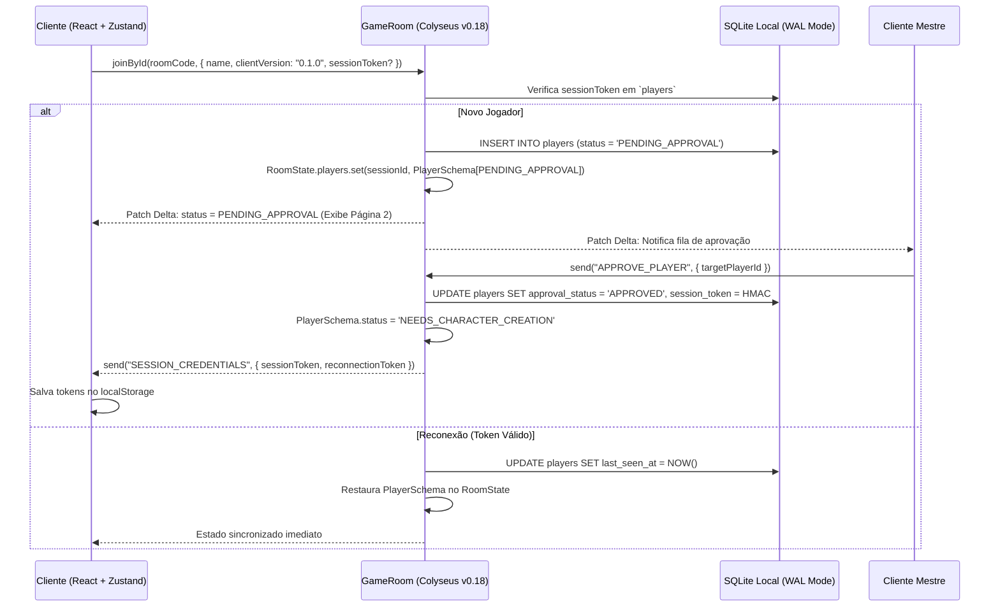

# Fase 1 — Fundação, Rede, Salas e Persistência Base (`v0.1.0`)

## 1. Escopo de Sistemas

### 1.1 Infraestrutura & Monorepo (Criar)
- `package.json`: Scripts globais (`dev`, `build`, `test`, `db:migrate`, `db:studio`, `start:host`).
- `pnpm-workspace.yaml`: Declaração dos pacotes `packages/*` e `apps/*`.
- `tsconfig.base.json`: Configuração TypeScript `^5.7.x` com `strict: true`, `moduleResolution: "bundler"`, `experimentalDecorators: true` e `useDefineForClassFields: false` (exigido pelos decorators do `@colyseus/schema`).

### 1.2 Contratos e Schemas Compartilhados (`packages/shared`) (Criar)
- `packages/shared/src/schema/PlayerSchema.ts`: Classe `PlayerSchema` herdando de `Schema` (`@colyseus/schema`), com campos `@type("string") id`, `@type("string") name`, `@type("string") role` (`'MASTER' | 'PLAYER'`), `@type("string") status` (`'PENDING_APPROVAL' | 'APPROVED' | 'REJECTED' | 'NEEDS_CHARACTER_CREATION'`), `@type("boolean") connected`.
- `packages/shared/src/schema/RoomState.ts`: Classe `RoomState` herdando de `Schema`, contendo `@type("string") roomCode`, `@type("string") sessionStatus` (`'LOBBY' | 'ACTIVE' | 'PAUSED'`), `@type({ map: PlayerSchema }) players = new MapSchema<PlayerSchema>()`.
- `packages/shared/src/schema/packets.ts`: Schemas Zod e tipos TypeScript para payloads WebSocket (`JoinRequestPayload`, `MasterAuthPayload`, `ApprovalDecisionPayload`, `VersionHandshakePayload`).
- `packages/shared/src/index.ts`: Barrel file exportando schemas, constantes de versão (`PROTOCOL_VERSION = "0.1.0"`) e validadores.

### 1.3 Banco de Dados Local & Servidor Autoritativo (`apps/server`) (Criar)
- `apps/server/drizzle.config.ts`: Apontamento para `./src/db/schema.ts` e pasta de saída `./src/db/migrations`.
- `apps/server/src/db/schema.ts`: Definição das tabelas SQLite via `drizzle-orm/sqlite-core`:
  - `_dungeons_migrations`: Controle interno (`version`, `applied_at`, `checksum`).
  - `rooms`: `id` (PK), `code` (UNIQUE, 5 chars), `master_password_hash`, `status`, `created_at`.
  - `players`: `id` (PK UUID), `room_id` (FK), `name`, `session_token` (UNIQUE), `reconnection_token`, `approval_status`, `last_seen_at`.
  - `sessions`: `id` (PK), `room_id` (FK), `status` (`'ACTIVE' | 'CLOSED'`), `updated_at`.
- `apps/server/src/db/index.ts`: Inicialização do `better-sqlite3` (`dungeons.db`), execução imediata de `sqlite.pragma('journal_mode = WAL')`, `sqlite.pragma('busy_timeout = 5000')`, `sqlite.pragma('foreign_keys = ON')` e runner automático de `migrate(db, { migrationsFolder })`.
- `apps/server/src/rooms/handlers/auth.ts`:
  - Gerador de código de sala de 5 dígitos com alfabeto sem ambiguidade (`ABCDEFGHJKLMNPQRSTUVWXYZ23456789` — excluindo `0`, `O`, `1`, `I`).
  - Geração e validação de `sessionToken` assinado (HMAC-SHA256) e vínculo com `reconnectionToken` nativo do Colyseus v0.18.
  - Fluxo de fila de espera (`PENDING_APPROVAL`) e comandos soberanos do Mestre (`APPROVE_PLAYER`, `REJECT_PLAYER`).
- `apps/server/src/rooms/GameRoom.ts`:
  - Ciclo de vida Colyseus v0.18: `onCreate`, `onAuth`, `onJoin`, `onDrop` (chamando `await this.allowReconnection(client, 60)` para quedas de rede móveis), `onLeave`.
  - Heartbeat explícito de Ping/Pong a cada 20 segundos (`setSimulationInterval` / `onMessage("PING")`) para evitar timeout de 100s do Cloudflare Tunnel.
  - Middleware de logging de rede com timestamp ISO, IP mascarado e RTT em ms.
- `apps/server/src/tunnel.ts`: Orquestrador CLI (`pnpm start:host`) que sobe o servidor na porta `2567`, instancia subprocesso `cloudflared tunnel --url http://localhost:2567`, extrai a URL `https://*.trycloudflare.com` via Regex no `stderr`/`stdout` e imprime QR Code ASCII (`qrcode-terminal`) com link direto `?room=XXXXX`.
- `apps/server/src/index.ts`: Bootstrap HTTP/WebSocket do Colyseus Server.

### 1.4 Cliente Frontend & Estado Global (`apps/client`) (Criar)
- `apps/client/vite.config.ts`: Configuração Vite 8 + React 19 + Tailwind CSS v4 (`@tailwindcss/vite`).
- `apps/client/src/store/useGameStore.ts`: Store Zustand contendo `roomCode`, `playerId`, `playerName`, `role`, `approvalStatus`, `connectionState` (`'DISCONNECTED' | 'CONNECTING' | 'CONNECTED' | 'RECONNECTING'`), `latencyMs`.
- `apps/client/src/store/useUIStore.ts`: Controle de modais, notificações do Mestre e tela ativa.
- `apps/client/src/network/colyseusClient.ts`: Wrapper sobre `@colyseus/sdk` (`Client`), gerenciando `joinOrCreate`, `joinById`, `reconnect(reconnectionToken)`, persistência em `localStorage` (`df_session_token`, `df_reconnection_token`, `df_room_code`) e loop de medição de ping.
- `apps/client/src/components/lobby/LobbyScreen.tsx`: Página 1 (Card de Reconexão Rápida condicional, inputs de 5 caracteres em caixa alta com auto-preenchimento via query param `?room=`, nome do aventureiro, e acordeão de acesso do Mestre por senha).
- `apps/client/src/components/lobby/WaitingRoomScreen.tsx`: Página 2 (Animação de espera do jogador, status em tempo real e botão cancelar).
- `apps/client/src/components/master/ApprovalQueuePopover.tsx`: Badge pulsante no topo da tela do Mestre com lista de jogadores pendentes e botões `[Aprovar]` e `[Recusar]`.

---

## 2. Ordem de Implementação

1. **Setup do Monorepo e Configurações Base**:
   - Criar `pnpm-workspace.yaml`, `tsconfig.base.json` e `package.json` raiz.
   - Inicializar os pacotes `packages/shared`, `apps/server` e `apps/client` garantindo que `pnpm -r build` compile `packages/shared` antes das aplicações.
2. **Contratos de Dados e Schemas Colyseus (`packages/shared`)**:
   - Implementar `PlayerSchema.ts`, `RoomState.ts` e `packets.ts` (Zod).
   - Exportar constantes de protocolo (`clientVersion: "0.1.0"`) para uso imediato no handshake.
3. **Camada de Persistência SQLite + Drizzle (`apps/server/src/db`)**:
   - Definir tabelas em `schema.ts` e gerar a migração `0000_init_foundation.sql`.
   - Implementar `db/index.ts` ativando `PRAGMA journal_mode = WAL;` na conexão do `better-sqlite3` e executando `migrate()` no boot antes de aceitar sockets.
4. **Handlers de Autenticação, Fila e Códigos de 5 Dígitos (`apps/server/src/rooms/handlers/auth.ts`)**:
   - Implementar o gerador de códigos sem caracteres ambíguos e persistência da sala na tabela `rooms`.
   - Implementar validação de senha do Mestre e registro de jogadores na tabela `players` com status `PENDING_APPROVAL`.
5. **Sala Autoritativa `GameRoom` e Reconexão (`apps/server/src/rooms/GameRoom.ts`)**:
   - Configurar `roomId` customizado com o código de 5 caracteres.
   - Implementar `onJoin`, `onDrop` (com `this.allowReconnection(client, 60)`), `onLeave` e handlers de aprovação (`APPROVE_PLAYER` / `REJECT_PLAYER`).
   - Configurar ping/pong de 20s e middleware de log de rede.
6. **Orquestrador Cloudflare Quick Tunnel (`apps/server/src/tunnel.ts`)**:
   - Criar script que inicia o servidor, abre o processo `cloudflared`, captura a URL HTTPS/WSS e desenha o QR Code no terminal.
7. **Cliente de Rede e Stores Zustand (`apps/client/src/network` & `store`)**:
   - Implementar `useGameStore.ts` e `colyseusClient.ts` sincronizando mutações do `RoomState` para o Zustand sem re-renderizações desnecessárias.
   - Implementar salvamento e leitura das chaves `df_session_token`, `df_reconnection_token` e `df_room_code` no `localStorage`.
8. **Telas de Lobby, Fila de Espera e Popover do Mestre (`apps/client/src/components/lobby`)**:
   - Construir `LobbyScreen.tsx` (incluindo leitura de `?room=` da URL e card de Reconexão Rápida).
   - Construir `WaitingRoomScreen.tsx` e `ApprovalQueuePopover.tsx` para o Mestre aprovar/recusar entradas em tempo real.
9. **Bateria de Testes Automatizados (Vitest + `@colyseus/testing`)**:
   - Escrever testes unitários do gerador de códigos e tokens (`packages/shared` / `apps/server`).
   - Escrever testes de migração em banco `:memory:` e testes de integração de sala/aprovação/reconexão com `@colyseus/testing`.

---

## 3. Integração e Dados

### 3.1 Fluxo de Estado e Sincronização Inicial
Por ser a **Fase 1 (Fundação)**, ela inaugura o pipeline de dados que sustentará todas as fases seguintes:

### 3.2 Persistência e Armazenamento
- **SQLite (`dungeons.db`)**:
  - Inicializado com migração `0000_init_foundation.sql`.
  - Garante que a sala ativa tenha registro em `sessions` com `status = 'ACTIVE'`.
- **LocalStorage do Navegador**:
  - `df_session_token`: Token criptográfico de longo prazo da sessão naquela sala.
  - `df_reconnection_token`: Token efêmero do Colyseus (`room.reconnectionToken`) para recuperação instantânea de socket.
  - `df_room_code`: Código de 5 caracteres da última sala acessada.

---

## 4. Checklist de Validação

- [ ] **Validação do Modo WAL e Migrações**: Executar `pnpm start:host` em ambiente limpo e verificar se os arquivos `dungeons.db`, `dungeons.db-wal` e `dungeons.db-shm` são criados automaticamente e se a tabela `_dungeons_migrations` registra a versão `0.1.0` no `pnpm db:studio` (porta `4983`).
- [ ] **Validação de Ambiguidade de Código de Sala**: Gerar 10.000 códigos via teste unitário e confirmar que todos têm 5 caracteres e **nenhum** contém `0`, `O`, `1` ou `I`.
- [ ] **Túnel Público e Auto-Preenchimento por QR Code**: Rodar `pnpm start:host`, escanear o QR Code ASCII no terminal com um smartphone conectado no 4G/5G (fora do Wi-Fi local) e verificar se a Página 1 abre com o código de 5 caracteres já preenchido.
- [ ] **Fila de Aprovação em Tempo Real (< 500ms)**: Entrar com 2 celulares simultaneamente na sala; verificar se ambos caem na tela *"Aguardando aprovação do Mestre..."* e se o Mestre recebe o badge pulsante. Aprovar o Jogador 1 e recusar o Jogador 2, validando a transição imediata de tela em ambos os aparelhos.
- [ ] **Teste de Queda Abrupta de Rede (`onDrop` / `allowReconnection`)**: No celular de um jogador aprovado, desligar o Wi-Fi por 10 segundos e religar; confirmar que o cliente reconecta sozinho sem duplicar o `PlayerSchema` no `RoomState`.
- [ ] **Teste de Reload Completo (F5 / Fechar Aba)**: Recarregar a página no navegador do jogador aprovado; verificar se o banner `[ Continuar como "Nome" na Sala #XXXXX ]` aparece ou reconecta direto recuperando o mesmo `player.id` no SQLite.
- [ ] **Teste de Heartbeat contra Timeout Cloudflare**: Manter 1 cliente conectado no celular sem realizar nenhuma ação por 3 minutos (180s > limite de 100s do Cloudflare) e confirmar nos logs de rede que os pacotes de Ping/Pong a cada 20s mantêm o WebSocket vivo sem desconexão.
