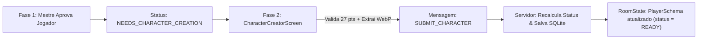

# Fase 2 — Fichas, Regras de RPG e Character Creator 2D (`v0.2.0`)

## 1. Escopo de Sistemas

### 1.1 Motor de Regras Matemáticas e Schemas (`packages/shared`) (Criar / Modificar)
- `packages/shared/src/rules/pointBuy.ts` (Criar):
  - Constantes de regra: `TOTAL_POINTS = 27`, `MIN_ATTR = 8`, `MAX_ATTR = 15`.
  - Tabela de custo acumulado por valor: `{ 8: 0, 9: 1, 10: 2, 11: 3, 12: 4, 13: 5, 14: 7, 15: 9 }`.
  - Funções puras: `calculatePointBuyCost(attributes)`, `canIncrementAttribute(currentValue, remainingPoints)`, `validatePointBuy(attributes): { valid: boolean; remaining: number; error?: string }`.
- `packages/shared/src/rules/races.ts` (Criar):
  - Catálogo tipado das 8 raças oficiais (`HUMAN`, `DWARF`, `ELF`, `ORC`, `VAMPIRE`, `DEMON`, `HALF_DRAGON`, `HALF_SHARK`) com modificadores de atributos e metadados de passivas:
    - `HUMAN`: +1 em todos + 1 ponto extra configurável (*Adaptabilidade*).
    - `DWARF`: +2 CON, +1 FOR, -1 DES | Passiva: `+1 DR` plana (*Resiliência das Rochas*).
    - `ELF`: +2 DES, +1 INT, -1 CON | Passiva: `+5%` esquiva passiva (*Graça Silvestre*).
    - `ORC`: +2 FOR, +1 CON, -2 INT | Passiva: `+2` dano físico se `HP < 30%` (*Fúria Indomável*).
    - `VAMPIRE`: +2 DES, +1 INT, -1 CON | Passiva: `20%` lifesteal corpo a corpo (*Toque Sanguíneo*).
    - `DEMON`: +2 INT, +1 FOR, -1 CAR | Passiva: Ignora `2 DR` em ataques mágicos (*Pacto Flamejante*).
    - `HALF_DRAGON`: +2 FOR, +1 CON, -1 SAB | Passiva: `+2` Defesa base (*Couraça Escamosa*).
    - `HALF_SHARK`: +2 DES, +1 FOR, -1 SAB | Passiva: `+2` dano corpo a corpo em alvos com `HP < 50%` (*Instinto Predador*).
- `packages/shared/src/rules/classes.ts` (Criar):
  - Catálogo dos 5 arquétipos (`WARRIOR`, `BARBARIAN`, `ROGUE`, `MAGE`, `CLERIC`), suas habilidades ativas de assinatura, custos de MP ou cooldown em rodadas.
- `packages/shared/src/rules/stats.ts` (Criar):
  - Funções determinísticas usando `Math.floor`:
    - `getModifier(attr) = Math.floor((attr - 10) / 2)`
    - `calculateMaxHp(conMod) = 100 + (conMod * 10)`
    - `calculateMaxMp(finalInt, wisMod) = Math.max(10, (finalInt * 2) + (wisMod * 5))`
    - `calculateBaseDefense(dexMod, raceId) = 10 + dexMod + (raceId === 'HALF_DRAGON' ? 2 : 0)`
    - `calculatePassiveDodge(dexMod, raceId) = Math.min(20, Math.max(0, 5 + (dexMod * 2) + (raceId === 'ELF' ? 5 : 0)))` (Teto global rígido de `20%`)
    - `calculateSpeed(dexMod) = Math.max(1, 2 + Math.floor(dexMod / 2))`
    - `calculateFlatDR(raceId) = raceId === 'DWARF' ? 1 : 0`
- `packages/shared/src/schema/PlayerSchema.ts` (Modificar):
  - Adicionar campos sincronizados de ficha resumida: `@type("string") characterId`, `@type("string") characterName`, `@type("string") raceId`, `@type("string") archetypeId`, `@type("number") hp`, `@type("number") maxHp`, `@type("number") mp`, `@type("number") maxMp`, `@type("number") defense`, `@type("number") speed`, `@type("string") tokenUrl`, `@type("string") portraitUrl`.
- `packages/shared/src/schema/packets.ts` (Modificar):
  - Adicionar `CharacterCreationSchema` (Zod) validando atributos base (`[8..15]`), ponto extra de Humano, `raceId`, `archetypeId`, `visualConfig` (camadas e cores RGB em hexadecimal) e strings base64 WebP (`portraitBase64`, `tokenBase64`).

### 1.2 Persistência e Validação no Servidor (`apps/server`) (Criar / Modificar)
- `apps/server/src/db/schema.ts` (Modificar):
  - Criar tabela `characters`: `id` (PK UUID), `player_id` (FK UNIQUE -> `players.id`), `room_id` (FK -> `rooms.id`), `name`, `race_id`, `archetype_id`, `base_str`, `base_dex`, `base_con`, `base_int`, `base_wis`, `base_cha`, `final_str`, `final_dex`, `final_con`, `final_int`, `final_wis`, `final_cha`, `hp`, `max_hp`, `mp`, `max_mp`, `defense`, `dodge_chance`, `speed`, `flat_dr`, `visual_config_json`, `portrait_webp` (TEXT/BLOB), `token_webp` (TEXT/BLOB), `created_at`.
  - Adicionar coluna `character_id` (`NULLABLE`) na tabela `players`.
- `apps/server/src/rooms/handlers/auth.ts` & `GameRoom.ts` (Modificar):
  - Handler `SUBMIT_CHARACTER`: valida payload com `CharacterCreationSchema` + `validatePointBuy()`, recalcula todos os status derivados no servidor (nunca confia nos status enviados pelo cliente), persiste na tabela `characters`, atualiza `PlayerSchema` no `RoomState` e altera `player.status` de `'NEEDS_CHARACTER_CREATION'` para `'READY'`.

IMPORTANTE para a criação do Character Creator 2D Modular e UI temos exemplos de personagens e como deveria ser a aparencia deles em todas as raças em imagens dentro de "DesignEX/CharacterModularExample" e a aparencia do ui como exemplo em "DesignEX/UiExample" em cada uma das pastas, as imagens tem nomes diferentes, mas todas são uteis, usar elas como inspiração
### 1.3 Character Creator 2D Modular e UI (`apps/client`) (Criar / Modificar) 
- `apps/client/src/game/characterCreator/ModularRenderer.ts` (Criar):
  - Instância PixiJS v8 (`Application`) dedicada ao preview 512x512.
  - Hierarquia de `Container` com ordenação estrita de `zIndex`:
    1. `00_back_hair` (cabelos longos traseiros)
    2. `10_body_base` (anatomia base por raça: silhueta crânio/mandíbula/pescoço)
    3. `20_skin_details` (escamas Meio-Dragão, guelras Meio-Tubarão, cicatrizes Orc)
    4. `30_ears` (humanas, pontudas Elfo, barbatanas Meio-Tubarão)
    5. `40_eyes_iris` (com fenda grossa para Meio-Tubarão, dracônica, brilhante Vampiro)
    6. `50_mouth_fangs` (presas inferiores Orc, caninos superiores Vampiro, dentes triangulares Tubarão)
    7. `60_facial_hair` (barbas e tranças Anão)
    8. `70_front_hair` (franjas e penteados)
    9. `80_horns` (chifres Demônio e Meio-Dragão)
  - Cada peça modular instancia um par de `Sprite`: `shadingSprite` (escala de cinza neutra que recebe `sprite.tint = hexColor`) + `lineartSprite` (contorno preto com `tint = 0xFFFFFF` sobreposto).
  - Gerenciamento explícito de ciclo de vida e memória para destruir texturas/containers órfãos ao desmontar (`destroy({ children: true, texture: false })`).
- `apps/client/src/game/characterCreator/TokenExporter.ts` (Criar):
  - Usa `await app.renderer.extract.canvas(targetContainer)` do PixiJS v8:
    - **Retrato HD**: Extrai o container completo em `512x512` e converte via `canvas.toDataURL('image/webp', 0.88)`.
    - **Token Circular**: Aplica máscara circular (`Graphics().circle(64, 64, 60).fill(0xffffff)`), sobrepõe anel de borda temática dourada/metálica em `128x128` e exporta via `canvas.toDataURL('image/webp', 0.88)`.
- `apps/client/src/components/character/CharacterCreatorScreen.tsx` (Criar):
  - Layout Split-Screen (Desktop) / Topo Compacto + Abas Deslizantes (Mobile).
  - Aba 1: Seleção de Raça (8 cards) e Arquétipo (5 cards) aplicando preset visual inicial da raça.
  - Aba 2: Point Buy de 27 pontos com botões `[ - ]` e `[ + ]` de `48x48px` (touch-friendly) e preview em tempo real de HP, MP, Defesa, Esquiva e Velocidade.
  - Aba 3: Customizador de peças modulares e seletores de cores RGB.

---

## 2. Ordem de Implementação

1. **Regras Matemáticas Puras (`packages/shared/src/rules`)**:
   - Implementar `pointBuy.ts`, `races.ts`, `classes.ts` e `stats.ts` usando exclusivamente aritmética inteira com `Math.floor`.
2. **Testes Unitários do Motor de Regras (`packages/shared`)**:
   - Validar todas as permutações de Point Buy, modificadores das 8 raças e tetos matemáticos (como o limite de 20% de esquiva passiva) antes de criar qualquer tela.
3. **Contratos de Rede e Migração SQLite `0001_add_characters_table.sql`**:
   - Atualizar `PlayerSchema.ts` e `packets.ts` com `CharacterCreationSchema`.
   - Atualizar `apps/server/src/db/schema.ts`, gerar a migração `0001` no Drizzle e criar o data transformer para manter jogadores antigos sem ficha no estado `NEEDS_CHARACTER_CREATION`.
4. **Handler Autoritativo de Criação de Ficha (`apps/server`)**:
   - Implementar o receptor `SUBMIT_CHARACTER` no `GameRoom.ts` que valida o Point Buy no servidor, recalcula status derivados, grava no SQLite e sincroniza no `RoomState`.
5. **Motor de Renderização Modular PixiJS v8 (`ModularRenderer.ts` e `TokenExporter.ts`)**:
   - Implementar o compositor de camadas `shading + lineart` com `sprite.tint` e `zIndex` determinístico.
   - Implementar o extrator WebP `512x512` (Retrato HD) e `128x128` (Token Circular com máscara).
6. **Interface de Criação de Personagem (`CharacterCreatorScreen.tsx`)**:
   - Construir as 3 abas responsivas conectadas às funções de `packages/shared/src/rules` para feedback instantâneo na UI.
   - Integrar o botão `[ Concluir Ficha e Entrar na Masmorra ]` que dispara o `TokenExporter`, envia o pacote via Colyseus e transita o jogador aprovado.

---

## 3. Integração e Dados

### 3.1 Conexão com a Fase 1
- Na **Fase 1**, quando o Mestre aprova um jogador na fila (`APPROVE_PLAYER`), o status do `PlayerSchema` mudava para `NEEDS_CHARACTER_CREATION`.
- Na **Fase 2**, o roteador em `apps/client/src/App.tsx` escuta `player.status === 'NEEDS_CHARACTER_CREATION'` (quando `characterId` é nulo) e renderiza automaticamente a `CharacterCreatorScreen`.
- Caso o jogador reconecte via `sessionToken` (da Fase 1) e já possua registro na tabela `characters`, o servidor carrega a ficha existente no `onJoin`/`onReconnect` e define `player.status = 'READY'`, pulando a criação de ficha.

### 3.2 Persistência e Migração (`v0.1.0` -> `v0.2.0`)
- **Migração `0001_add_characters_table.sql`**:
  - Adiciona a tabela `characters` e a coluna `character_id TEXT NULL` em `players`.
  - Totalmente aditiva (Non-Breaking): sessões criadas na `v0.1.0` migram sem perda de conexões.
- **Armazenamento do Cliente**:
  - Salva rascunho em `localStorage` (`df_char_draft_${roomCode}`) enquanto o jogador edita a ficha para não perder escolhas caso atualize a página no celular antes de submeter.

---

## 4. Checklist de Validação

Registro atualizado em **13/11/2026**, considerando os testes automatizados e de navegador executados durante a implementação, além da confirmação do usuário de funcionamento no PC e no celular.

Os itens marcados indicam que seus critérios funcionais foram verificados. No caso do WebP, dimensões, transparência e tamanho foram conferidos por inspeção automatizada das exportações, e a persistência foi coberta pelos testes de integração SQLite; não foi realizada inspeção manual no Drizzle Studio. A revisão visual incluiu 16 variações das oito raças e verificações de recorte das íris e pupilas.

O teste de memória permanece pendente: as 100 trocas verificaram 18 texturas ativas e descarte ao desmontar, mas não mediram o consumo real de memória da GPU no Chrome DevTools.

- [x] **Validação Matemática do Point Buy**: Tentar criar um personagem no cliente gastando 28 pontos ou reduzindo um atributo para 7 via inspeção de rede (payload adulterado); confirmar que o servidor rejeita a mensagem `SUBMIT_CHARACTER` com erro de validação Zod/PointBuy.
- [x] **Verificação das 8 Raças e Teto de Esquiva**: Criar um Elfo (+2 DES, +5% esquiva racial) com Destreza base 15 (total 17, `mod_DES = +3`); confirmar que a Esquiva Passiva calculada no cliente e no banco SQLite respeita `min(20%, 5 + 6 + 5) = 16%`, e que mesmo forçando `DES = 24` em teste unitário a esquiva crava em `20%`.
- [x] **Teste da Passiva Humana (*Adaptabilidade*)**: Selecionar a raça Humano e verificar se a UI exige a alocação de `+1` ponto extra em um atributo à escolha além do `+1` universal.
- [x] **Inspeção Visual de Camadas (`zIndex`) e Tinting**: Alternar entre todas as 8 raças (incluindo chifres de Demônio/Meio-Dragão, guelras/olhos de fenda grossa de Meio-Tubarão, presas de Orc/Vampiro e barbas de Anão) trocando cores de pele e cabelo; confirmar que a lineart preta permanece intacta e que nenhuma camada atravessa o rosto incorretamente.
- [ ] **Teste de Memory Leak no PixiJS v8**: Trocar de penteado, raça e cor 100 vezes seguidas na tela de criação monitorando `renderer.texture.managedTextures` no Chrome DevTools; confirmar que o consumo de memória de GPU permanece estável.
- [x] **Qualidade e Tamanho da Exportação WebP**: Submeter a ficha e inspecionar no Drizzle Studio (`pnpm db:studio`) os campos `portrait_webp` (512x512) e `token_webp` (128x128); confirmar que o fundo externo do token circular é 100% transparente e que ambos os arquivos pesam menos de 50KB juntos.
- [x] **Ergonomia Mobile**: Testar a tela de criação em viewport mobile (`375x667`), garantindo que os botões `[ - ]` e `[ + ]` possuem área mínima de `44x44px` e que o preview do personagem permanece visível enquanto se ajustam os atributos.
/