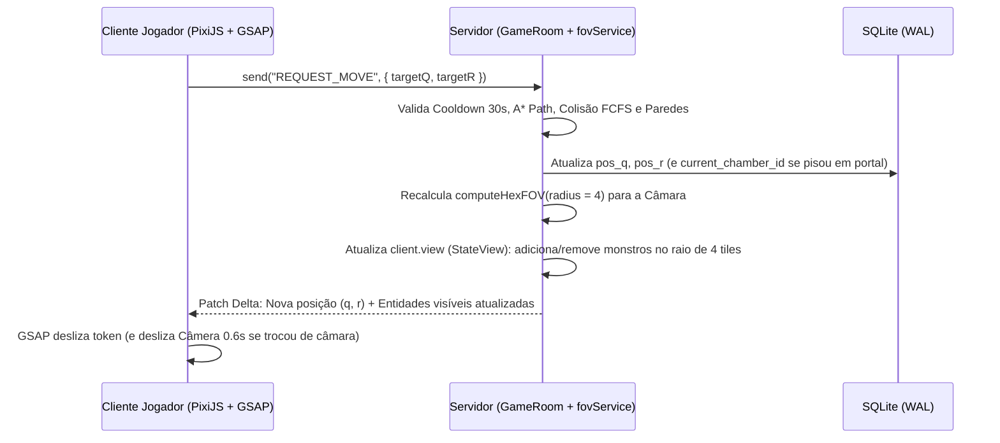

# Fase 3 — Tabuleiro Hexagonal, Câmaras Contíguas e Névoa Autoritativa (`v0.3.0`)

## 1. Escopo de Sistemas

### 1.1 Matemática Hexagonal, A* e FOV (`packages/shared/src/hex`) (Criar)
- `packages/shared/src/hex/coordinates.ts`:
  - Geometria **Pointy-Topped (`⬢`)** com raio $R$ (ex: `HEX_SIZE = 40px`).
  - Conversões exatas:
    - `axialToCube(q, r): { x: q, y: -q - r, z: r }` e `cubeToAxial(x, y, z)`.
    - `hexToPixel(q, r, size): { x: size * sqrt(3) * (q + r/2), y: size * (3/2) * r }`.
    - `pixelToHex(px, py, size)` seguido de `cubeRound(fracX, fracY, fracZ)` para precisão de clique/toque.
    - `getHexKey(q, r): "${q},${r}"` para indexação rápida em `Map` e schemas.
- `packages/shared/src/hex/distance.ts`:
  - `hexDistance(a, b) = (Math.abs(a.q - b.q) + Math.abs(a.q + a.r - b.q - b.r) + Math.abs(a.r - b.r)) / 2`.
  - `getHexNeighbors(q, r)` (6 direções axiais) e `getHexRing(center, radius)` (anéis de alcance até $N$ tiles).
- `packages/shared/src/hex/pathfinding.ts`:
  - Algoritmo **A\* Hexagonal** (`findHexPath(start, goal, isWalkable, getTerrainCost)`):
  - Respeita paredes segmentadas entre hexágonos adjacentes, bloqueia água profunda/obstáculos e aplica bloqueio rígido de destino ocupado (**FCFS**).
- `packages/shared/src/hex/fov.ts`:
  - Algoritmo de Linha de Visada (`computeHexFOV(origin, maxRadius = 4, blocksSight)`):
  - Interpolação linear cúbica (`hexLinedraw`) de `origin` até cada hexágono dentro do raio de **4 hexágonos**, verificando colisão com células opacas ou segmentos de parede nas arestas.

### 1.2 Schemas de Mapa, Câmaras e StateView (`packages/shared/src/schema`) (Criar / Modificar)
- `packages/shared/src/schema/ChamberSchema.ts` (Criar):
  - `PortalSchema`: `fromQ`, `fromR`, `targetChamberId`, `toQ`, `toR`.
  - `ChamberSchema`: `id`, `name`, `biome`, `bounds` (`minQ, maxQ, minR, maxR`), `cells` (terrenos), `walls` (arestas bloqueadas), `portals` (`ArraySchema<PortalSchema>`).
- `packages/shared/src/schema/MonsterSchema.ts` & `PlacedObjectSchema.ts` (Criar):
  - Entidades dinâmicas de mapa marcadas com decorator `@view()` do `@colyseus/schema` (Colyseus v0.18) para controle estrito de visibilidade por cliente (`client.view = new StateView()`).
- `packages/shared/src/schema/PlayerSchema.ts` (Modificar):
  - Adicionar `@type("string") currentChamberId`, `@type("number") q`, `@type("number") r`, `@type("number") moveCooldownEndsAt`, `@type("number") remainingSteps`.
- `packages/shared/src/schema/RoomState.ts` (Modificar):
  - Adicionar `@type("string") activeStageId`, `@type("string") explorationMode` (`'DUNGEON_TENSE_30S' | 'FREE_EXPLORATION'`), `@type({ map: ChamberSchema }) chambers`, `@type({ map: MonsterSchema }) monsters`, `@type({ map: PlacedObjectSchema }) objects`.

### 1.3 Movimento Autoritativo, Culling FOV e Editor do Mestre (`apps/server`) (Criar / Modificar)
- `apps/server/src/db/schema.ts` (Modificar):
  - Criar tabelas `maps` (fases reutilizáveis: Taverna, Masmorra, etc.), `chambers`, `terrain_cells`, `walls`, `placed_objects` e `editor_history` (pilha de Undo/Redo da sessão).
  - Adicionar colunas `current_chamber_id`, `pos_q`, `pos_r` na tabela `characters`.
- `apps/server/src/services/fovService.ts` (Criar):
  - Calcula a união dos conjuntos de visão ativa (raio de 4 hexágonos) de todos os jogadores presentes na mesma `Chamber`.
  - **Culling Rígido Autoritativo**: Atualiza o `client.view` (`StateView`) de cada jogador conectado para adicionar **apenas** entidades (`MonsterSchema`, baús, objetos interativos e outros jogadores) que:
    1. Estejam na mesma `currentChamberId` do jogador;
    2. Estejam dentro do raio de 4 hexágonos de visão ativa compartilhada da câmara;
    3. Não estejam marcados com `isHiddenByMaster = true`.
  - O cliente do Mestre possui todas as entidades de todas as câmaras adicionadas ao seu `client.view`.
- `apps/server/src/rooms/handlers/movement.ts` (Criar):
  - Validação autoritativa do caminho enviado ou calculado via A*:
    - Verifica colisão com paredes/água e regra **FCFS** (nenhuma entidade pode terminar o movimento no mesmo `(q, r)` de outra).
    - No modo `DUNGEON_TENSE_30S`: desconta passos de `remainingSteps` (baseado em `player.speed`) e inicia cooldown de `30.000ms` ao esgotar ou encerrar passo.
    - No modo `FREE_EXPLORATION`: aplica apenas trava anti-spam de `1.000ms`.
    - Prioridade Soberana do Mestre: comando `MASTER_MOVE_ENTITY` ignora cooldown, cancela movimento concorrente do jogador e reposiciona imediatamente.
    - Detecção de Portal: ao pisar em `(fromQ, fromR)` de um `PortalSchema`, transfere o jogador para `(targetChamberId, toQ, toR)`, limpa a memória de névoa da câmara anterior para aquele cliente e recalcula `fovService`.
- `apps/server/src/rooms/handlers/master.ts` (Criar):
  - Comandos de edição em tempo real em 4 camadas (Terreno com expansão dinâmica de borda, Paredes, Objetos rotacionáveis/sobrepostos, Entidades/Spawn), alternador de elemento `Oculto` e pilha ilimitada de `Undo / Redo` (`Ctrl+Z` / `Ctrl+Y`).

### 1.4 Tabuleiro PixiJS v8, Camadas, Névoa e HUD (`apps/client`) (Criar)
- `apps/client/src/game/PixiApp.ts` & `scenes/BoardScene.ts`:
  - Inicialização WebGPU/WebGL2 em tela cheia (`100vw x 100vh`) com suporte a pan (arrastar com inércia), zoom (roda do mouse e *pinch-to-zoom* de 2 dedos no celular) e modo Debug (`Ctrl+Shift+D` exibindo `(q, r)` e raios de LOS).
  - Transição de câmera deslizante com **GSAP** (`gsap.to(viewport, { x, y, duration: 0.6, ease: "power2.inOut" })`) ao trocar de câmara.
- `apps/client/src/game/layers/`:
  - `TerrainLayer.ts`: Renderização em lote de hexágonos Pointy-Topped (grama, pedra, terra, areia, água) e highlight pulsante do caminho A* alcançável.
  - `WallLayer.ts`: Segmentos vetoriais/texturizados nas arestas dos hexágonos.
  - `ObjectLayer.ts`: Mesas, cadeiras, portas, tochas e baús (com menu contextual de desempate em caso de sobreposição).
  - `EntityLayer.ts`: Tokens circulares (`128x128` gerados na Fase 2) interpolados suavemente hexágono a hexágono via GSAP.
  - `FogOfWarLayer.ts`: Máscara usando `RenderTexture` com 3 estados visuais:
    1. `ACTIVE_VISION` (raio de 4 tiles): 100% nítido/iluminado com gradiente suave nas bordas.
    2. `EXPLORED_MEMORY` (terreno já visto na câmara atual): Sombreado a 50% de opacidade mostrando apenas chão e paredes (sem monstros/baús).
    3. `UNEXPLORED` (nunca visto ou câmara anterior): 100% escuro (`#09090b`).
- `apps/client/src/components/hud/` & `master/`:
  - HUD do Jogador: Header com indicador circular do cooldown de 30s, mini-card de HP/MP no canto inferior esquerdo.
  - Interface do Mestre: Alternador `[Modo Tenso 30s / Modo Livre]`, botão `[Focar Câmara / Visão Macro Panorâmica]`, botões `[Undo / Redo]`, Sidebar de fases reutilizáveis e Toolbar de edição em 4 camadas + botão `Oculto`.

---

## 2. Ordem de Implementação

1. **Núcleo Matemático Hexagonal (`packages/shared/src/hex`)**:
   - Implementar `coordinates.ts`, `distance.ts`, `pathfinding.ts` (A*) e `fov.ts` (raio de 4 hexágonos).
   - Validar com testes unitários que `pixelToHex(hexToPixel(q, r))` tem erro zero e que o A* contorna paredes de aresta.
2. **Schemas de Câmara, Mapa e Migração `0002_add_maps_and_chambers.sql`**:
   - Criar `ChamberSchema`, `MonsterSchema` e `PlacedObjectSchema` com decorators `@view()`.
   - Criar tabelas no Drizzle (`maps`, `chambers`, `terrain_cells`, `walls`, `placed_objects`) e script seed gerando a *"Masmorra de Treinamento (3 Câmaras Contíguas)"*.
3. **Serviço Autoritativo de FOV e Culling de Rede (`apps/server/src/services/fovService.ts`)**:
   - Implementar o cálculo de visibilidade no servidor e o gerenciamento de `StateView` por cliente para impedir vazamento de pacotes de monstros fora dos 4 hexágonos.
4. **Handlers de Movimento FCFS, Cooldown 30s e Portais (`apps/server/src/rooms/handlers/movement.ts`)**:
   - Implementar movimentação validada por A*, bloqueio de colisão FCFS, relógio de cooldown de 30s, transição de câmara em portais e prioridade soberana do Mestre.
5. **Renderizador do Tabuleiro e Camadas no PixiJS v8 (`apps/client/src/game`)**:
   - Implementar `BoardScene.ts`, `TerrainLayer.ts`, `WallLayer.ts`, `ObjectLayer.ts` e `EntityLayer.ts` consumindo o `tokenUrl` gerado na Fase 2.
6. **Camada de Névoa de Guerra e Deslize de Câmera GSAP (`FogOfWarLayer.ts`)**:
   - Implementar o `RenderTexture` de névoa com memória local por câmara (que reseta ao cruzar um portal) e a transição `gsap.to` de `0.6s` entre câmaras contíguas.
7. **Ferramentas de Edição do Mestre e Undo/Redo (`apps/server/src/rooms/handlers/master.ts` + UI)**:
   - Implementar os pincéis das 4 camadas (com expansão automática de limites ao pintar além da borda), flag `Oculto` e histórico `Undo/Redo`.

---

## 3. Integração e Dados

### 3.1 Conexão com a Fase 2
- Na **Fase 2**, o personagem finalizado gerou `speed` (derivado da Destreza) e `token_webp` (`128x128`), ficando com status `'READY'`.
- Na **Fase 3**, ao entrar no estado `'READY'`, o servidor posiciona o jogador no hexágono de spawn (`spawn_q, spawn_r`) da Câmara Inicial (respeitando a regra de não-sobreposição: se o spawn estiver ocupado, aloca no hexágono livre adjacente mais próximo via `getHexRing`).
- O `EntityLayer.ts` no PixiJS carrega a textura do `token_webp` da Fase 2 para renderizar o peão do jogador no grid, e o `movement.ts` usa o atributo `speed` calculado na Fase 2 como limite de passos por ciclo de 30 segundos.

### 3.2 Persistência e Migração (`v0.2.0` -> `v0.3.0`)
- **Migração `0002_add_maps_and_chambers.sql`**:
  - Cria as tabelas estruturais de mapas e adiciona `current_chamber_id`, `pos_q` e `pos_r` em `characters` com valores `DEFAULT` apontando para o spawn da Câmara 1.
  - Executa seed automático criando a masmorra padrão caso o banco ainda não possua mapas cadastrados.

---

## 4. Checklist de Validação

- [ ] **Auditoria Anti-Cheat de Rede (Culling FOV de 4 Hexágonos)**: Posicionar um monstro a 5 hexágonos do jogador ou atrás de uma parede fechada; abrir a aba Network -> WS no Chrome DevTools do cliente do jogador e confirmar que os dados daquele monstro **não existem** nos pacotes nem na memória do cliente até que o jogador se aproxime para 4 hexágonos com linha de visada limpa.
- [ ] **Validação dos 3 Estados da Névoa e Limpeza de Câmara**: Caminhar por uma câmara verificando se o raio de 4 tiles ilumina suavemente e se os tiles deixados para trás ficam sombreados em 50% (mostrando paredes, mas escondendo monstros). Atravessar um portal para a Câmara 2, voltar para a Câmara 1 e confirmar que a memória da Câmara 1 foi apagada de volta à escuridão total.
- [ ] **Transição Deslizante de Câmera (60 FPS)**: Cruzar a passagem entre duas câmaras contíguas no celular e confirmar que a câmera faz o pan suave em `0.6s` (`power2.inOut`) enquadrando a nova sala sem engasgos.
- [ ] **Disputa Concorrente FCFS (Não-Sobreposição)**: Em teste automatizado (`@colyseus/testing`) e manual com 2 jogadores, clicar para mover para o mesmo hexágono vazio simultaneamente; confirmar que o primeiro ocupa a célula e o segundo recebe rejeição limpa permanecendo no hexágono anterior sem dessincronização visual.
- [ ] **Prioridade Soberana do Mestre**: Enquanto um jogador tenta mover seu token, o Mestre arrasta o mesmo token para outra posição; confirmar que a posição definida pelo Mestre prevalece imediatamente e o indicador de cooldown de 30s funciona conforme o modo selecionado (`Modo Tenso 30s` vs `Modo Livre`).
- [ ] **Edição em 4 Camadas, Expansão de Borda e Undo/Redo**: Com o Mestre, pintar chão além da borda atual da câmara (verificando expansão dinâmica do grid), traçar paredes, colocar um baú marcado como `Oculto` (invisível para o jogador mesmo a 1 tile de distância) e pressionar `Ctrl+Z` / `Ctrl+Y` 10 vezes seguidas verificando restauração exata do mapa.
