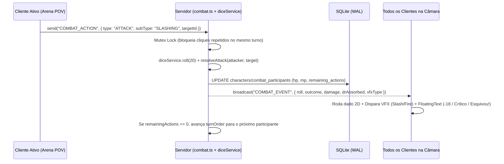

# Fase 4 — Arena de Combate POV, Ações, Fórmulas e VFX (`v0.4.0`)

## 1. Escopo de Sistemas

### 1.1 Mecânicas de Combate, Dano e Ações (`packages/shared/src/combat`) (Criar / Modificar)
- `packages/shared/src/combat/actions.ts` (Criar):
  - Enumeração e contratos das 4 grandes ações universais (`ATTACK`, `DEFEND`, `ITEM`, `FLEE`) e seus subtipos:
    - `ATTACK`: Golpes físicos (`SLASHING`, `BLUNT`, `THRUST`, `UNARMED`), Habilidades de Arquétipo (`WARRIOR`, `BARBARIAN`, `ROGUE`) ou Magias Ofensivas (`FIRE`, `ICE`, `LIGHT`, `DARKNESS`, `ARCANE`).
    - `DEFEND`: `ACTIVE_DODGE` (prepara contra-teste `1d20 + mod_DES` contra o próximo ataque recebido), `SHIELD_BLOCK` (redução física direta) e magias curativas/protetoras.
    - `ITEM`: Uso de consumível rápido no turno.
    - `FLEE`: Teste de fuga baseado em velocidade vs média de velocidade dos inimigos, sujeito às flags soberanas do Mestre (`fleeBlocked: boolean`, `guaranteedFlee: boolean`).
  - Cálculo de **Ações Adicionais por Turno**:
    - `calculateTotalActions(str, int): { count: 1 + Math.floor(Math.max(str, int) / 20), extraType: str >= int ? 'PHYSICAL_ONLY' : 'MAGICAL_ONLY' }`.
    - Validador que proíbe estritamente o uso de ações extras para a ação `FLEE`.
- `packages/shared/src/combat/damage.ts` (Criar):
  - Pipeline determinístico de resolução de ataque:
    1. **Checagem de Esquiva Ativa (`ACTIVE_DODGE`)**: Se o defensor estiver em postura `ACTIVE_DODGE`, rola `1d20 + defender.dexMod` vs `attackRoll`. Se `dodgeRoll >= attackRoll`, retorna `{ outcome: 'DODGED_ACTIVE', finalDamage: 0 }`.
    2. **Checagem de Esquiva Passiva (Teto 20%)**: Se não esquivou ativamente, sorteia `1d100 <= Math.min(20, defender.passiveDodge)`. Se verdadeiro, retorna `{ outcome: 'DODGED_PASSIVE', finalDamage: 0 }`.
    3. **Cálculo de Dano Bruto + Crítico**: Aplica multiplicador crítico (`2.0x` em `d20 === 20` ou faixa crítica configurada pelo Mestre) e passivas condicionais:
       - `ORC` (*Fúria Indomável*): `+2` dano físico se `attacker.hp < attacker.maxHp * 0.30`.
       - `HALF_SHARK` (*Instinto Predador*): `+2` dano corpo a corpo se `defender.hp < defender.maxHp * 0.50`.
    4. **Mitigação por Redução de Dano (DR Plana)**:
       - `effectiveDR = Math.max(0, defender.flatDR - (isMagic && attacker.raceId === 'DEMON' ? 2 : 0))` (Passiva *Pacto Flamejante* do Demônio ignora 2 de DR em magia).
       - `finalDamage = Math.max(1, rawDamage - effectiveDR)` (Garante dano mínimo `>= 1` sempre que o golpe atingir).
    5. **Pós-Efeito de Lifesteal**:
       - `VAMPIRE` (*Toque Sanguíneo*): `healAmount = isMelee ? Math.floor(finalDamage * 0.20) : 0`.
- `packages/shared/src/schema/RoomState.ts` (Modificar):
  - Criar `CombatStateSchema` contendo: `active` (`boolean`), `biome` (`'CAVE' | 'FOREST' | 'TAVERN' | 'DUNGEON'`), `round` (`number`), `turnOrder` (`ArraySchema<string>`), `activeParticipantId` (`string`), `remainingActions` (`number`), `fleeMode` (`'NORMAL' | 'BLOCKED' | 'GUARANTEED_100'`), `isPaused` (`boolean`).

### 1.2 Máquina de Estados de Combate e Sorteador de Dados (`apps/server`) (Criar / Modificar)
- `apps/server/src/db/schema.ts` (Modificar):
  - Criar tabelas `monsters_catalog`, `combat_encounters`, `combat_participants` e `active_buffs` (migração `0003_add_combat_system.sql`).
- `apps/server/src/services/diceService.ts` (Criar):
  - Gerador criptograficamente uniforme (`crypto.randomInt(1, faces + 1)`) para `d4`, `d6`, `d8`, `d10`, `d12`, `d20`, `d100`.
  - Avaliador de faixas de corte configuráveis pelo Mestre no `d20` (`CRITICAL_FAILURE`, `FAILURE`, `SUCCESS`, `CRITICAL_SUCCESS`).
- `apps/server/src/rooms/handlers/combat.ts` (Criar):
  - Detector de proximidade (1 a 2 hexágonos no fim de cada movimento da Fase 3) que envia notificação discreta ao Mestre: `PROXIMITY_ALERT` (`[Inimigo próximo! Iniciar Combate]`).
  - Inicializador de encontro (`START_COMBAT`): coleta participantes da câmara, ordena a fila `turnOrder` por `Speed / Destreza` (decrescente) e muda o estado da sala para `IN_COMBAT`.
  - Executor de turno com trava de concorrência (`isProcessingAction` mutex por turno para impedir duplo clique/pacotes duplicados durante animações).
  - Comandos da **Barra de Árbitro do Mestre**: `MASTER_PAUSE_COMBAT`, `MASTER_SET_FLEE_MODE`, `MASTER_REORDER_INITIATIVE`, `MASTER_FORCE_TURN_SKIP`, `MASTER_MANUAL_MONSTER_ACTION`, `MASTER_END_COMBAT`.
  - Simulador CLI de equilíbrio (`apps/server/src/scripts/combatSim.ts` via `pnpm test:combat-sim`) executando 10.000 turnos headless.

### 1.3 Arena Visual POV, VFX com GSAP e Bandeja de Dados (`apps/client`) (Criar)
- `apps/client/src/game/scenes/CombatPOVScene.ts`:
  - Renderização em perspectiva frontal JRPG/Pokémon com background ilustrado dinâmico pelo bioma da câmara (`CAVE`, `FOREST`, `TAVERN`, `DUNGEON`).
  - Sprites frontais dos monstros centralizados com animação contínua de respiração (*idle breathing* via `gsap.to(sprite.scale, { y: 1.03, yoyo: true, repeat: -1 })`), barras de HP/status sobre a cabeça e **Retícula Dourada de Mira** ao selecionar alvo.
- `apps/client/src/game/vfx/`:
  - `combatEffects.ts`: Animações procedurais/sprites em PixiJS + GSAP para cada tipo de golpe:
    - `SLASHING` (arco luminoso cortando o alvo), `BLUNT` (impacto com centelhas e poeira), `THRUST` (feixe perfurante veloz), `FIRE` (espiral flamejante), `ICE` (estilhaços congelantes), `LIGHT` (feixe dourado), `DARKNESS` (névoa roxa/negra).
  - `floatingText.ts`: Números flutuantes com física GSAP:
    - Dano normal: vermelho (`-18`).
    - Dano crítico: dourado ampliado + *screen shake* na câmera da arena (`gsap.fromTo(scene, { x: -8 }, { x: 8, repeat: 5, yoyo: true })`).
    - Esquiva: texto azul `"Esquivou!"` com rastro de silhueta do defensor.
    - Mitigação DR: ícone de escudo exibindo o valor absorvido.
  - `diceAnimation.ts`: Rolagem 2D sincronizada para todos os clientes pousando no número exato sorteado pelo `diceService` no servidor.
- `apps/client/src/components/combat/`:
  - `CombatOverlay.tsx`: Cards de aliados no topo lateral (clicáveis para cura/buffs), card do jogador ativo no canto inferior esquerdo ( usando o `portrait_webp` 512x512 da Fase 2) e **Doca Inferior de Batalha** com os 4 grandes botões táteis (`[⚔️ Atacar]`, `[🛡️ Defender]`, `[🎒 Itens]`, `[🏃 Fugir]`).
  - `MasterRefereeBar.tsx`: Barra superior exclusiva do Mestre para pausar, forçar fuga 100%, reordenar fila ou clicar em um monstro para assumir seus ataques manualmente.

---

## 2. Ordem de Implementação

1. **Serviço Determinístico de Dados e Fórmulas de Combate (`packages/shared/src/combat` & `diceService.ts`)**:
   - Implementar `damage.ts`, `actions.ts` e `diceService.ts`.
   - Criar o script `pnpm test:combat-sim` e os testes unitários validando DR (dano mínimo >= 1), teto de 20% de esquiva passiva, contra-teste de esquiva ativa (`1d20 + mod_DES`) e ações extras por `FOR/INT >= 20`.
2. **Schemas de Combate e Migração `0003_add_combat_system.sql`**:
   - Atualizar `RoomState.ts` com `CombatStateSchema`.
   - Criar as tabelas `monsters_catalog`, `combat_encounters`, `combat_participants` e `active_buffs` no SQLite e popular o seed inicial (*Goblin*, *Esqueleto Guerreiro*, *Cultista Arcano*).
3. **Máquina de Estados de Combate no Servidor (`apps/server/src/rooms/handlers/combat.ts`)**:
   - Implementar o detector de proximidade de 1-2 hexágonos, montagem da fila de iniciativa por Velocidade/Destreza, trava anti-duplo-clique de turno, resolução das 4 ações e comandos soberanos do Mestre.
4. **Cena PixiJS `CombatPOVScene.ts` e Transição de Câmera**:
   - Implementar a troca suave da `BoardScene` (Fase 3) para a `CombatPOVScene` ao receber `combatState.active = true`, carregando o cenário do bioma da câmara atual e posicionando os monstros de frente com retícula de mira.
5. **Sistema de VFX, Números Flutuantes e Dados 2D (`combatEffects.ts`, `floatingText.ts`, `diceAnimation.ts`)**:
   - Implementar os efeitos visuais por tipo de dano/elemento, o *screen shake* em acertos críticos e a bandeja de dados poliédricos sincronizada.
6. **HUD da Arena POV e Barra de Árbitro do Mestre (`CombatOverlay.tsx` & `MasterRefereeBar.tsx`)**:
   - Construir a doca tátil com os 4 botões, seleção de alvos (monstros ou cards de aliados) e o modo de controle manual de monstros pelo Mestre.

---

## 3. Integração e Dados

### 3.1 Conexão com as Fases 2 e 3
- Da **Fase 2**, o combate consome diretamente os atributos finais, modificadores, passivas raciais (Orc, Vampiro, Demônio, Anão, Elfo, Meio-Tubarão, Meio-Dragão), habilidades de arquétipo e o retrato HD (`portrait_webp` 512x512) exibido no card do jogador ativo.
- Da **Fase 3**, o gatilho de combate lê as coordenadas `(q, r)` no grid hexagonal: quando `hexDistance(player, monster) <= 2` dentro da mesma `Chamber`, dispara o alerta para o Mestre. Além disso, o campo `chamber.biome` da Fase 3 define qual background frontal é carregado na `CombatPOVScene`.

### 3.2 Persistência e Migração (`v0.3.0` -> `v0.4.0`)
- **Migração `0003_add_combat_system.sql`**:
  - Cria as tabelas de encontros e catálogo de monstros.
  - Se o servidor sofrer restart com um encontro `ACTIVE`, a sala restaura `CombatStateSchema` a partir de `combat_encounters` e `combat_participants`, reabrindo os clientes diretamente na Arena POV no turno exato em que parou.

---

## 4. Checklist de Validação

- [ ] **Gatilho de Proximidade e Transição POV**: Mover um jogador no tabuleiro hexagonal até ficar a 2 hexágonos de um Goblin; confirmar que o alerta `[Inimigo próximo! Iniciar Combate]` aparece para o Mestre e, ao clicar, todos os clientes na câmara transitam suavemente para a Arena POV com o fundo correspondente ao bioma.
- [ ] **Mitigação de DR e Regra de Dano Mínimo 1**: Atacar um Esqueleto Guerreiro (ex: `DR = 5`) com um golpe fraco que cause `4` de dano bruto; confirmar no log de auditoria e no número flutuante que o dano aplicado na barra de HP é exatamente `1` (nunca `0` ou negativo) com o ícone de escudo indicando absorção de DR.
- [ ] **Contra-Teste de Esquiva Ativa (`Defender`)**: No turno do Jogador 1, clicar em `[🛡️ Defender -> Esquiva Ativa]`. No turno do monstro, atacar o Jogador 1; verificar se o servidor executa o contra-teste `1d20 + mod_DES` contra o ataque e, ao vencer, exibe o texto azul `"Esquivou!"` com `0` de dano sofrido.
- [ ] **Validação de Ações Adicionais (`FOR` ou `INT >= 20`)**: Configurar um Guerreiro com `FOR = 20` (`1 + floor(20/20) = 2 ações`); confirmar que após realizar 1 ataque físico ele ainda possui 1 ação física extra no mesmo turno, mas que o botão `[🏃 Fugir]` fica bloqueado nessa ação extra.
- [ ] **Trava de Concorrência (Spam Click)**: Clicar 15 vezes rapidamente no botão `[⚔️ Atacar]` no celular durante o próprio turno; confirmar que o servidor processa apenas 1 ação e ignora os pacotes duplicados.
- [ ] **Soberania da Barra de Árbitro do Mestre**: Durante o combate, testar os controles do Mestre: (1) bloquear a fuga e verificar o cadeado no botão `[🏃 Fugir]` dos jogadores; (2) ativar `"100% de Chance de Fuga"` e confirmar que o próximo clique do jogador em `[🏃 Fugir]` encerra o encontro com sucesso garantido; (3) clicar em um monstro na arena e executar manualmente o golpe dele contra um herói.
