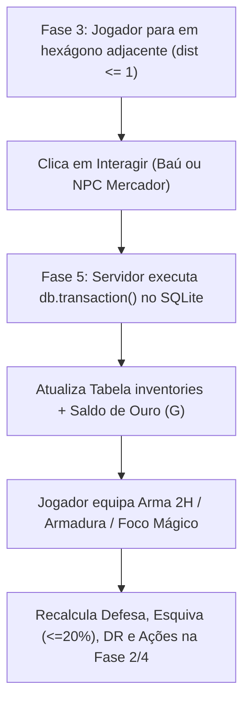

# Fase 5 — Economia, Itens, NPCs e IA Tática dos Monstros (`v0.5.0`)

## 1. Escopo de Sistemas
IMPORTANTE, TEMOS EXEMPLOS DOS SPRITES DE ARMAS E ARMADURAS DENTRO DE DESIGNEX, com suas proprias pastas cada

### 1.1 Regras de Equipamentos, Consumíveis e Feitiços (`packages/shared/src/rules`) (Criar / Modificar)
- `packages/shared/src/rules/items.ts` (Criar):
  - Catálogo canônico de itens com propriedades tipadas (`id`, `name`, `category`, `handedness`, `slot`, `basePriceGold`, `damageDice`, `damageType`, `rangeHex`, `defenseBonus`, `drBonus`, `dexPenalty`, `dodgeMod`, `maxDexBonus`):
    - **Armas de 2 Mãos (`TWO_HANDED`)**: Espada Grande, Machado de Batalha, Lança Longa (ocupam `mainHand` e forçam `offHand = null`).
    - **Armas de 1 Mão (`ONE_HANDED`)**: Espada Curta, Adaga, Maça (permitem escudo ou *Dual Wielding* em `offHand`).
    - **Longo Alcance (`RANGED`)**: Arco Curto, Besta (`rangeHex: 4`).
    - **Focos Mágicos (`MAGIC_FOCUS`)**: Cajado Arcano, Varinha, Foco Divino (requisito obrigatório para canalizar magias).
    - **Armaduras (`ARMOR`)**:
      - `LIGHT`: `+2 Defesa`, mantém `mod_DES` integral, `+5% Esquiva` (respeitando o teto global de 20%).
      - `MEDIUM`: `+4 Defesa`, limita contribuição de `mod_DES` na Defesa a `max(+2)`.
      - `HEAVY`: `+7 Defesa`, `+2 DR plana`, penalidade de `-2 DES` e `-10% Esquiva`.
    - **Consumíveis (`CONSUMABLE`)**: Poção de Vida, Poção de Mana, Antídoto (remove veneno), Livro Mágico (`+bônus` de dano mágico por $N$ rodadas), **'O Suco'** (multiplicador `1.20x` no dano físico por $N$ rodadas), Pergaminhos de Feitiço e Itens Narrativos (chaves, cordas, tochas).
  - Funções puras de gerenciamento de slots e economia:
    - `equipItemValidator(currentEquipment, newItem): { updatedEquipment, unequippedToBag: Item[] }` (desequipa automaticamente o escudo/arma secundária se equipar arma `TWO_HANDED`, e vice-versa).
    - `calculateSellPrice(basePriceGold) = Math.floor(basePriceGold * 0.50)` (recompra fixa a 50% em inteiros).
- `packages/shared/src/rules/spells.ts` (Criar):
  - Catálogo inicial das 4 magias essenciais e validador de canalização (`canCastSpell(character, spell)` verificando foco mágico equipado e `mp >= spell.mpCost`):
    1. `ARCANE_DART` (*Dardo Arcano*): `4 MP`, alcance `4 hex`, alvo único, dano base `INT`.
    2. `IGNEOUS_BLAST` (*Explosão Ígnea*): `10 MP`, alcance `4 hex`, área de **7 hexágonos** (hexágono central + os 6 vizinhos retornados por `getHexNeighbors`), dano base `INT`.
    3. `HEALING_LIGHT` (*Luz Curativa*): `6 MP`, alcance `3 hex` (ou próprio), cura `HP` com base em `SAB`.
    4. `FREEZING_RAY` (*Raio Congelante*): `8 MP`, alcance `4 hex`, alvo único, dano de gelo + aplica debuff `-1 Speed` por 1 rodada.

### 1.2 IA Tática de Monstros, Lojas de NPCs e Baús (`apps/server`) (Criar / Modificar)
- `apps/server/src/db/schema.ts` (Modificar):
  - Criar tabelas `items_catalog`, `spells_catalog`, `inventories` (slots `MAIN_HAND`, `OFF_HAND`, `ARMOR`, `BAG` + `quantity`), `character_grimoire`, `npc_shops` e `chests` (migração `0004_add_items_economy_spells.sql`).
  - Adicionar coluna `gold INTEGER NOT NULL DEFAULT 50` na tabela `characters`.
- `apps/server/src/rooms/ai/tacticalAi.ts` (Criar):
  - Máquina de decisão executada quando `monster.isAutoMode === true` (individual ou global):
    1. Localiza o jogador vivo mais próximo usando `hexDistance`.
    2. **Comportamento Corpo a Corpo (`MELEE`)**: Calcula caminho via `findHexPath` (A* da Fase 3) até um hexágono adjacente ao alvo; desloca até o limite de `monster.speed` e, se atingir adjacência (`distance === 1`), executa ataque físico.
    3. **Comportamento Longo Alcance / Mago (`RANGED`)**: Mantém distância ideal de `3 a 4 hexágonos` com linha de visada limpa (`computeHexFOV`). Se `distance === 1` (jogador colado), calcula A* de recuo para afastar antes de disparar.
    4. **Restrição Rígida**: Nunca executa a ação `FLEE` a menos que `monster.allowAutoFlee === true` tenha sido habilitado pelo Mestre.
- `apps/server/src/rooms/handlers/shop.ts` (Criar):
  - Validação de adjacência hexagonal (`hexDistance(player, target) <= 1`) para abrir baús (`OPEN_CHEST`), saquear itens (`LOOT_CHEST_ITEM`) ou negociar com NPC (`BUY_ITEM`, `SELL_ITEM`).
  - **Transações Atômicas SQLite (`db.transaction(...)`)**:
    - Na coleta de baú compartilhado: remove o item do baú e insere no inventário do jogador na mesma transação síncrona do `better-sqlite3`, impedindo duplicação de itens (*item duping*) em cliques simultâneos.
    - Na compra/venda: valida `character.gold >= price`, impede saldo negativo/decimal e bloqueia venda de itens atualmente equipados no corpo.
- `apps/server/src/rooms/handlers/chatAndLog.ts` (Criar):
  - Broadcast de mensagens de chat efêmeras (`CHAT_MESSAGE` com TTL de 7 segundos, sem persistência em banco) e eventos de auditoria para a gaveta de Log de Combate/Rolagens da sessão.

### 1.3 Modais de Loja, Gaveta de Inventário/Grimório e Chat Efêmero (`apps/client`) (Criar / Modificar)
- `apps/client/src/components/hud/ShopModal.tsx` (Criar):
  - Página 6: Cabeçalho com retrato do NPC, diálogo customizado pelo Mestre e saldo de Ouro (`💰 G`).
  - Aba `[🛒 Comprar]`, Aba `[💰 Vender (+50%)]` (com cadeado nos itens equipados) e modo `[✏️ Editar Loja]` exclusivo do Mestre.
- `apps/client/src/components/hud/CharacterSheetDrawer.tsx` (Criar):
  - Gaveta retrátil unificada (Bottom Sheet no mobile / Drawer lateral no desktop) com 3 abas:
    1. `Ficha`: Atributos, passiva racial, habilidade ativa de arquétipo e status recalibrados pelos equipamentos.
    2. `Equipamentos & Mochila`: Os 3 slots rígidos (`Mão Principal`, `Mão Secundária`, `Armadura`), grade da mochila com contadores (`x3`) e saldo de Ouro.
    3. `Grimório`: Lista de feitiços aprendidos, custo de MP e botão para ler/consumir Pergaminhos da mochila.
- `apps/client/src/components/hud/EphemeralChatBubble.tsx` & `CombatLogDrawer.tsx` (Criar):
  - Balões de fala renderizados sobre o token do jogador no tabuleiro que somem com fade-out após **7 segundos**.
  - Gaveta lateral com histórico cronológico de dados rolados e danos causados na sessão.

---

## 2. Ordem de Implementação

1. **Catálogos e Validadores de Itens, Slots e Magias (`packages/shared/src/rules/items.ts` & `spells.ts`)**:
   - Implementar as regras de mãos (`1H` vs `2H`), modificadores de armaduras (`Leve`, `Média`, `Pesada`), cálculo de venda a `50%`, área de 7 hexágonos da *Explosão Ígnea* e requisitos de foco mágico.
   - Cobrir com testes unitários em `packages/shared`.
2. **Migração `0004_add_items_economy_spells.sql` e Seeds Canônicos (`apps/server/src/db`)**:
   - Criar tabelas `items_catalog`, `spells_catalog`, `inventories`, `character_grimoire`, `npc_shops` e `chests`, além da coluna `gold` em `characters`.
   - Rodar seeder populando armas, armaduras, poções ('O Suco', Vida, Mana, Antídoto), pergaminhos e concedendo 2 magias iniciais aos conjuradores + `50G` para fichas existentes.
3. **Handlers Transacionais de Inventário, Baús e Lojas (`apps/server/src/rooms/handlers/shop.ts`)**:
   - Implementar transações ACID síncronas (`db.transaction`) para equipar/desequipar itens, saquear baús adjacentes, comprar/vender em NPCs e distribuir itens pelo painel do Mestre.
4. **Integração de Equipamentos e Magias no Combate (`apps/server/src/rooms/handlers/combat.ts`)**:
   - Conectar os bônus de arma equipada, armadura, consumíveis ('O Suco' `1.20x`, Veneno por turno, Livro Mágico) e as 4 magias iniciais ao motor de resolução da Fase 4.
5. **Motor de IA Tática de Monstros (`apps/server/src/rooms/ai/tacticalAi.ts`)**:
   - Implementar a tomada de decisão automática para monstros `MELEE` (avanço A* + ataque) e `RANGED` (manutenção de 3-4 hexágonos de distância com LOS + recuo se colado).
6. **Interfaces de Loja, Gaveta de Ficha/Mochila/Grimório, Chat 7s e Log (`apps/client`)**:
   - Construir `ShopModal.tsx`, `CharacterSheetDrawer.tsx`, `EphemeralChatBubble.tsx` e `CombatLogDrawer.tsx`.

---

## 3. Integração e Dados

### 3.1 Conexão com as Fases 2, 3 e 4
- **Com a Fase 2 (Status)**: Equipar uma Armadura Pesada ou Escudo na Fase 5 dispara o recálculo imediato de `defense`, `dodge_chance`, `speed` e `flat_dr` sobre a ficha base criada na Fase 2.
- **Com a Fase 3 (Grid, A* e FOV)**:
  - A interação com Baús e NPCs exige validação de adjacência (`hexDistance <= 1`) usando as coordenadas `(q, r)` da Fase 3.
  - A IA Tática (`tacticalAi.ts`) reutiliza diretamente o algoritmo `findHexPath` (A*) e `computeHexFOV` construídos na Fase 3 para decidir o posicionamento dos monstros.
- **Com a Fase 4 (Arena POV)**:
  - Os submenus de `[⚔️ Atacar]` e `[🎒 Itens]` da Arena POV passam a listar dinamicamente a arma equipada nos slots `mainHand`/`offHand`, os feitiços do `character_grimoire` e as poções reais presentes na tabela `inventories`.

### 3.2 Persistência e Migração (`v0.4.0` -> `v0.5.0`)
- **Migração `0004_add_items_economy_spells.sql`**:
  - Adiciona `gold INTEGER NOT NULL DEFAULT 50` em `characters` (preservando fichas das versões `v0.2.0`-`v0.4.0`).
  - Popula `items_catalog` e `spells_catalog` via `INSERT OR IGNORE` idempotente.

---

## 4. Checklist de Validação

- [ ] **Regra Rígida de Mãos (`1H` vs `2H`)**: Equipar uma Espada de 1 Mão e um Escudo; em seguida, equipar um Machado de 2 Mãos pela gaveta de inventário no celular. Confirmar que o Escudo é automaticamente movido para a mochila (`offHand = null`) e a Defesa do personagem é recalculada na hora.
- [ ] **Impacto de Armaduras e Teto de Esquiva**: Equipar uma Armadura Pesada (`+7 Defesa, +2 DR, -2 DES, -10% Esquiva`) e verificar a atualização imediata dos atributos na aba `Ficha` e na redução de dano sofrido na Arena POV.
- [ ] **Teste Anti-Duplicação em Baú Compartilhado (Concorrência)**: Posicionar 2 jogadores adjacentes ao mesmo baú contendo `1x Espada Rara`; disparar o comando `LOOT_CHEST_ITEM` simultaneamente pelos dois clientes em teste de integração e verificar que apenas 1 jogador recebe o item e o baú fica vazio no SQLite.
- [ ] **Comércio com NPC e Recompra a 50%**: Comprar uma adaga de `40G` em um NPC mercador (saldo cai de `50G` para `10G`); tentar vendê-la enquanto equipada (deve estar bloqueada com cadeado); desequipar e vender na aba `[💰 Vender]`, confirmando o recebimento exato de `+20G` (saldo vai para `30G`).
- [ ] **Aprendizado de Pergaminho e Canalização de Feitiço em Área**: Usar um Pergaminho de *Explosão Ígnea* na mochila, verificar que ele desaparece da bolsa e entra no `Grimório`. Tentar conjurar sem Cajado/Varinha equipado (deve bloquear); equipar o Cajado e conjurar na batalha, validando que o cálculo de área atinge exatamente os **7 hexágonos** (centro + 6 adjacentes) e desconta `10 MP`.
- [ ] **Comportamento da IA Tática Automática**: Ativar a chave `"Modo Automático"` para 1 Goblin Guerreiro (`MELEE`) e 1 Cultista Arcano (`RANGED`); confirmar que o Goblin avança pelo menor caminho A* até colar no herói mais próximo e ataca, enquanto o Cultista mantém distância de 3-4 hexágonos (recuando caso um jogador encoste nele) e nunca tenta fugir sozinho.
- [ ] **Chat Efêmero de 7 Segundos**: Enviar uma mensagem de texto e cronometrar: o balão de fala deve surgir sobre o token do personagem e desaparecer após 7 segundos, sem deixar registros salvos no SQLite ao fechar a sala.
