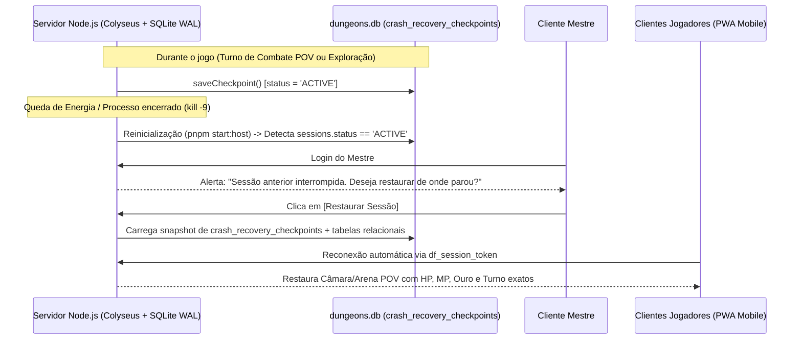

# Fase 6 — Polimento, PWA Mobile, Sistema de Áudio e Crash Recovery (`v1.0.0 - Release Candidate`)

## 1. Escopo de Sistemas

### 1.1 Sistema de Áudio Imersivo e Audio Sprites (`apps/client/src/audio`) (Criar / Modificar)
- `apps/client/public/audio/`:
  - Assets de áudio otimizados: `sfx-sprite.webm` e fallback `sfx-sprite.mp3` contendo todos os efeitos sonoros consolidados em um único arquivo com mapa de timestamps (`dice_roll`, `footstep_stone`, `footstep_grass`, `sword_slash`, `blunt_hit`, `bow_shoot`, `spell_fire`, `spell_ice`, `spell_heal`, `dodge_whoosh`, `portal_transition`, `coins_jingle`, `chest_open`, `master_thunder`, `master_door_slam`).
  - Faixas de BGM em loop (`bgm_exploration.webm`, `bgm_combat_pov.webm`).
- `apps/client/src/store/useAudioStore.ts` (Criar):
  - Estado persistido em `localStorage` (`df_audio_prefs`): `masterVolume` (`0.0..1.0`), `bgmVolume` (`0.0..1.0`), `sfxVolume` (`0.0..1.0`), `isMuted` (`boolean`), `audioUnlocked` (`boolean`).
- `apps/client/src/audio/soundManager.ts` (Criar):
  - Wrapper sobre **Howler.js (`^2.2.4`)**:
    - Desbloqueio automático do `AudioContext` no primeiro evento `pointerdown` / `touchend` do usuário no navegador mobile (iOS Safari / Chrome Android).
    - `playSfx(spriteKey)`: disparo instantâneo com latência zero a partir do sprite carregado em memória.
    - `crossfadeBgm(targetTrack, durationMs = 1200)`: interpolação suave usando `howl.fade()` ao alternar entre a `BoardScene` (exploração) e a `CombatPOVScene` (batalha POV).
    - Listener para o pacote `MASTER_NARRATIVE_SFX` permitindo que o Mestre dispare efeitos sonoros dramáticos sincronizados em todos os clientes.

### 1.2 PWA Standalone, Service Worker e Gestos Mobile (`apps/client`) (Criar / Modificar)
- `apps/client/vite.config.ts` & `public/manifest.json` (Modificar):
  - Configuração do `vite-plugin-pwa` (Workbox):
    - `display: "standalone"`, `orientation: "any"`, `theme_color: "#0f172a"`, `background_color: "#09090b"`, ícones `192x192`, `512x512` e `maskable`.
    - Estratégia **Cache-First** (`CacheFirst` com `ExpirationPlugin` de 30 dias) para `assets/**/*.{webp,png,svg}`, `audio/**/*.{webm,mp3}` e fontes.
    - Estratégia **Network-First / Network-Only** para rotas de handshake e conexões WebSocket do Colyseus.
- `apps/client/src/game/scenes/BoardScene.ts` & Componentes Mobile (Modificar):
  - Refinamento ergonômico de gestos multitoque:
    - Separação com histerese de movimento (`dragThreshold = 8px`) entre *tap* (selecionar hexágono para andar) e *pan/pinch* (arrastar câmera ou fazer zoom de pinça com 2 dedos), impedindo movimentos acidentais do personagem ao dar zoom no celular.
    - Prevenção de pull-to-refresh e zoom nativo da página (`touch-action: none`, `overscroll-behavior: none`).

### 1.3 Crash Recovery Autoritativo, Sanitização e Índices (`apps/server`) (Criar / Modificar)
- `apps/server/src/db/schema.ts` (Modificar):
  - Migração final `0005_finalize_mvp_schema.sql`:
    - Criar tabela `crash_recovery_checkpoints`: `id` (PK), `room_id` (FK UNIQUE), `session_id` (FK), `serialized_room_state` (TEXT JSON snapshot), `combat_snapshot_json` (TEXT NULL), `last_event_type`, `updated_at`.
    - Criar índices compostos de performance: `idx_players_room_token` em `players(room_id, session_token)`, `idx_cells_chamber_qr` em `terrain_cells(chamber_id, q, r)`, `idx_inventories_char_slot` em `inventories(character_id, slot)`.
- `apps/server/src/services/crashRecoveryService.ts` (Criar):
  - `saveCheckpoint(room)`: Grava snapshot transacional em `crash_recovery_checkpoints` e mantém `sessions.status = 'ACTIVE'` a cada evento crítico (movimento confirmado, mudança de câmara, fim de turno de combate, transação de loja, edição do Mestre).
  - `detectInterruptedSession()`: Executado na inicialização do servidor e quando o Mestre faz login. Se encontrar uma sessão com `status = 'ACTIVE'` que não foi encerrada pelo comando `"Encerrar Sessão"`, sinaliza `HAS_INTERRUPTED_SESSION`.
  - `restoreSessionFromCheckpoint(roomId)` / `discardInterruptedSession(roomId)`: Restaura integralmente câmaras, posições `(q, r)`, HP/MP, inventários e o turno exato do combate ativo, ou limpa a sessão caso o Mestre escolha descartar.
- `apps/server/src/scripts/sanitizeDb.ts` (`pnpm db:sanitize`) (Criar):
  - Utilitário de manutenção que remove sessões órfãs encerradas, compacta logs temporários, executa `PRAGMA wal_checkpoint(TRUNCATE);` e `PRAGMA integrity_check;`.

---

## 2. Ordem de Implementação

1. **Migração `0005_finalize_mvp_schema.sql`, Índices e Script `pnpm db:sanitize`**:
   - Adicionar a tabela `crash_recovery_checkpoints` e os índices compostos no SQLite.
   - Implementar o teste automatizado de regressão de migrações aplicando `0000` até `0005` sequencialmente em banco `:memory:`.
2. **Serviço de Crash Recovery no Servidor e Modal de Restauração do Mestre**:
   - Implementar `crashRecoveryService.ts` conectado aos hooks de evento do `GameRoom.ts` e ao botão `"Encerrar Sessão"`.
   - Criar o modal prioritário na tela do Mestre: *"Sessão anterior interrompida. Deseja restaurar de onde parou?"* com botões `[ Restaurar Sessão ]` e `[ Descartar e Criar Nova ]`.
3. **Sistema de Áudio Howler.js e Audio Sprites (`soundManager.ts` & `useAudioStore.ts`)**:
   - Configurar o carregamento do sprite de áudio único (`sfx-sprite.webm`/`mp3`) e as trilhas de BGM.
   - Conectar os gatilhos sonoros aos eventos das Fases 3, 4 e 5 (passos, dados, golpes, feitiços, moedas, portais, crossfade de batalha POV) e adicionar o painel de SFX Narrativo para o Mestre.
4. **Configuração PWA Workbox e Refinamento Multitoque Mobile**:
   - Configurar `vite-plugin-pwa` com `CacheFirst` para assets gráficos/sonoros e manifesto standalone.
   - Ajustar a histerese de *pinch-to-zoom* vs *tap* no `BoardScene.ts` e auditar todos os alvos de toque (`>= 44x44px`).
5. **Bateria de Testes End-to-End (Playwright / Vitest)**:
   - Implementar a suíte E2E automatizada cobrindo o fluxo completo da Fase 1 à Fase 6 (criação de sala -> fila -> criação de ficha Point Buy -> exploração no grid -> combate POV -> loja -> crash recovery).

---

## 3. Integração e Dados

### 3.1 Conexão com Todas as Fases Anteriores (1 a 5)
A **Fase 6** atua como a camada transversal de resiliência, imersão audiovisual e entrega mobile sobre todos os subsistemas construídos:
- **Áudio (`soundManager.ts`)** escuta os eventos de rede e transições de cena das **Fases 3, 4 e 5**:
  - `combatState.active` mudando de `false -> true` dispara `crossfadeBgm('bgm_combat_pov', 1200)`.
  - Eventos `COMBAT_EVENT` (Fase 4) e `SHOP_TRANSACTION` (Fase 5) acionam os marcadores correspondentes do Audio Sprite.
- **Crash Recovery (`crashRecoveryService.ts`)** consolida em um único checkpoint ACID os estados de:
  - `players` e `sessions` (**Fase 1**);
  - `characters` com HP/MP atuais (**Fase 2**);
  - `current_chamber_id`, `pos_q`, `pos_r` e edições do mapa (**Fase 3**);
  - `combat_encounters` e fila de iniciativa ativa (**Fase 4**);
  - `inventories`, `gold` e `chests` abertos (**Fase 5**).

### 3.2 Persistência e Fechamento do Ciclo de Migrações (`v0.5.0` -> `v1.0.0`)
- **Migração `0005_finalize_mvp_schema.sql`**:
  - Consolida índices e a tabela `crash_recovery_checkpoints`.
- **Service Worker & Cache Storage (Cliente)**:
  - Versiona o cache de assets (`df-assets-v1.0.0`) limpando automaticamente caches antigos no evento `activate` do Service Worker.

---

## 4. Checklist de Validação

- [ ] **Teste Brutal de Crash Recovery (`kill -9` no meio do Combate)**: Iniciar uma batalha POV com 2 jogadores, causar dano em um monstro e gastar MP; encerrar abruptamente o processo do servidor Node.js no terminal (`Stop-Process -Force` / `kill -9`) sem clicar em "Encerrar Sessão". Subir `pnpm start:host` novamente, logar como Mestre, confirmar que o prompt *"Sessão anterior interrompida. Deseja restaurar de onde parou?"* aparece e que, ao aceitar, o combate reabre no turno exato com os mesmos valores de HP, MP, Ouro e posições no mapa.
- [ ] **Validação de Áudio Mobile (Desbloqueio iOS/Android & Audio Sprite)**: Abrir o jogo em um iPhone (Safari) e em um Android (Chrome); verificar que após o primeiro toque na tela todos os SFX do sprite tocam instantaneamente sem atraso de rede e que o crossfade entre a música de exploração e a de combate POV ocorre sem cortes secos.
- [ ] **Sincronização de SFX Narrativo do Mestre**: Acionar no painel do Mestre o efeito sonoro de `"Trovão"` ou `"Porta Pesada"` e confirmar que o som toca simultaneamente nos celulares de todos os jogadores conectados.
- [ ] **Instalação PWA Standalone e Cache-First**: Instalar o aplicativo na tela inicial do celular ("Adicionar à tela inicial"), abrir o app em modo tela cheia (sem barra de URL do navegador) e inspecionar na aba Network do DevTools que as texturas do Character Creator, terrenos e `sfx-sprite.webm` são servidos instantaneamente a partir do Service Worker (`(ServiceWorker)` / `0ms` de rede).
- [ ] **Auditoria Google Lighthouse e Ergonomia de Toque**: Executar auditoria Lighthouse Mobile garantindo pontuação de **PWA = 100%**, **Performance >= 90** e testar o gesto de pinça (*pinch-to-zoom*) no tabuleiro certificando que dar zoom com 2 dedos nunca dispara um clique acidental de movimento do personagem.
- [ ] **Suíte E2E Automatizada e Regressão de Banco (`v0.1.0` -> `v1.0.0`)**: Executar `pnpm test:e2e` e o teste de migração sequencial das 6 versões (`0000` a `0005`), confirmando 100% de aprovação sem violação de chaves estrangeiras.
- [ ] **Playtest Final — "Mesa Zero" (90 a 120 Minutos)**: Conduzir uma sessão real contínua com 1 Mestre no PC e 3 a 4 jogadores em celulares via Cloudflare Quick Tunnel (misturando Wi-Fi e 4G/5G), passando por criação de fichas, exploração de 3 câmaras com névoa, 2 combates (manual e IA automática), comércio em NPC e rolagens de dados, encerrando com zero crashes ou perdas de sincronização.
