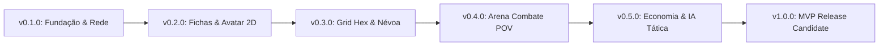
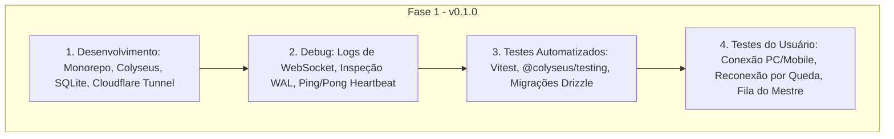
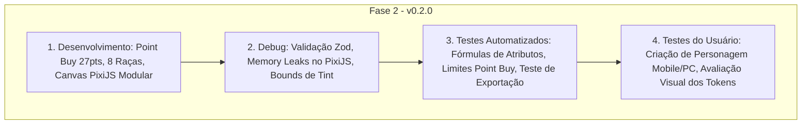
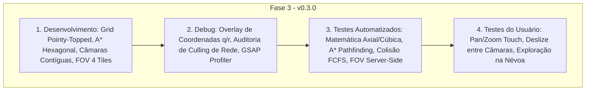
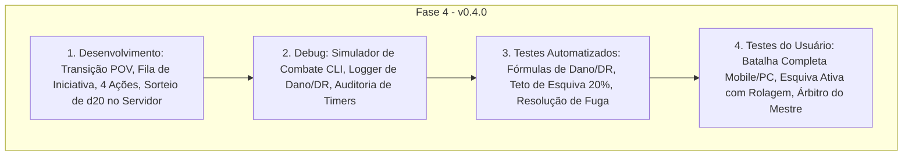
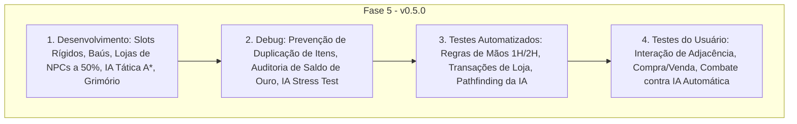
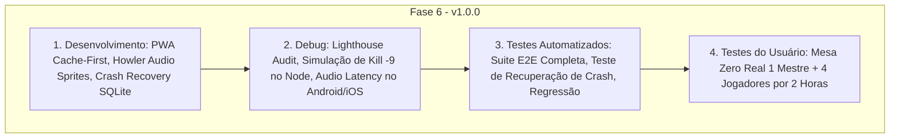

# Roadmap Estratégico do MVP — Dungeons & Friends

Este documento define o planejamento de lançamento incremental do **Produto Mínimo Viável (MVP)** de **Dungeons & Friends**, dividido em versões sucessivas. Cada fase segue rigorosamente uma estrutura em **4 partes**:
1. **Desenvolvimento** (Escopo técnico e features)
2. **Debug** (Ferramentas de inspeção, logging e rotinas de depuração)
3. **Testes Automatizados** (Testes unitários, de integração, schemas e contratos)
4. **Testes do Usuário** (Critérios de aceitação, usabilidade tátil mobile e playtests reais)

Além disso, detalha a **Estratégia de Versionamento, Sanitização e Migração Contínua de Dados** para assegurar compatibilidade absoluta entre versões tanto no **Banco Local (SQLite via Drizzle)** quanto no **Banco de Dados do Servidor/Remoto** e **Armazenamento do Cliente (LocalStorage/IndexedDB)**.

---

## 1. Visão Geral do Ciclo de Versões do MVP

---

## 2. Estratégia de Atualização de Dados e Migração Entre Versões

Para evitar falhas de incompatibilidade, corrupção de sessões ou discrepâncias durante a transição entre versões de testes, o projeto adota um protocolo obrigatório de integridade de dados.

### 2.1 Camadas de Dados Afetadas
1. **Banco de Dados Local do Mestre (SQLite via `better-sqlite3` + `drizzle-orm`)**:
   - Armazena salas ativas, estado estrutural das masmorras, inventários, fichas e checkpoints de crash.
2. **Banco de Dados do Servidor / Catálogo Central (PostgreSQL / SQLite Central)**:
   - Armazena catálogo canônico versionado de raças, monstros, magias, itens e tabelas globais.
3. **Armazenamento Local do Cliente (LocalStorage & IndexedDB)**:
   - Persiste `sessionToken`, `lastRoomCode`, preferências visuais/áudio e cache de tokens gráficos.

### 2.2 Protocolo de Migração a Cada Versão
- **Versionamento Semântico de Schema (`schema_version`)**:
  - Cada versão incrementa uma tabela interna `_dungeons_migrations` gravando `version`, `applied_at` e `checksum`.
- **Pipeline Automático no Bootstrap (`pnpm db:migrate`)**:
  - Ao iniciar o servidor (`pnpm start:host`), o Drizzle ORM compara o schema atual e executa automaticamente as migrações SQL incrementais pendentes antes de liberar as conexões de rede do Colyseus.
- **Princípio de Aditividade sem Quebra (Non-Breaking Changes)**:
  - Novas colunas em tabelas de versões anteriores **sempre** declaram valor padrão (`DEFAULT`) ou aceitam `NULL`.
  - Nenhuma coluna ou tabela é apagada de forma destrutiva durante o ciclo do MVP; campos obsoletos são marcados como `@deprecated` no TypeScript e transformados por scripts de sanitização.
- **Handshake de Versão do Cliente (Version Guard)**:
  - Ao conectar, o cliente envia seu cabeçalho: `{ clientVersion: "0.3.0", sessionToken: "..." }`.
  - O servidor valida compatibilidade. Se o token pertencer a uma versão antiga com schema modificado, uma rotina de auto-reparo (*data transformer*) atualiza o registro do jogador em segundo plano, evitando travamentos de tela branca.
- **Seeds e Resets Controlados para Testes (`pnpm db:seed:vX.Y`)**:
  - Scripts dedicados para popular cenários de teste pré-configurados compatíveis com a versão ativa, permitindo rodar testes automatizados do zero em bancos isolados em memória (`:memory:`).

---

## 3. Fases do Roadmap do MVP

---

### Fase 1 — Fundação, Rede, Salas e Persistência Base (v0.1.0)
*Objetivo: Estabelecer a infraestrutura de monorepo, salas com código de 5 dígitos, fila de aprovação do Mestre, reconexão por token e baseline dos bancos de dados.*

#### Parte 1: Desenvolvimento
- Configuração do monorepo pnpm workspaces (`packages/shared`, `apps/server`, `apps/client`).
- Setup do servidor Colyseus com sala `GameRoom` gerando códigos alfanuméricos de 5 dígitos (ex: `K8X2M`).
- Script orquestrador `apps/server/src/tunnel.ts` (`pnpm start:host`) integrando Cloudflare Quick Tunnel com renderização de URL pública e QR Code ASCII no terminal.
- Fila de espera e aprovação em tempo real: jogador entra em estado `PENDING_APPROVAL`, Mestre recebe notificação e aprova/rejeita.
- Geração de `sessionToken` persistente salvo no SQLite local e no `localStorage` do cliente.
- Mecânica de reconexão transparente: reconectar à mesma sala mantendo a vaga e o identificador do jogador.
- Configuração do SQLite em modo `WAL` (`journal_mode = WAL`) com Drizzle ORM.

#### Parte 2: Debug
- Implementação de middleware de logging de rede com carimbo de tempo, IP mascarado e latência estimada.
- Ferramenta de inspeção do banco local com Drizzle Studio (`pnpm db:studio`) na porta `4983`.
- Teste de degradação: simulação de encerramento abrupto da conexão WebSocket (queda forçada) para inspecionar resposta do heartbeat (ping a cada 20s) e re-handshake com token.
- Verificação de locks de arquivo no SQLite em concorrência de leitura e escrita.

#### Parte 3: Testes Automatizados
- **Testes Unitários**:
  - Gerador de código de sala (garantir formato de 5 dígitos alfanuméricos sem caracteres ambíguos como 0/O, 1/I).
  - Validação do gerador e validador de `sessionToken` com expiração e assinatura rápida.
- **Testes de Integração de Rede**:
  - Bateria com `@colyseus/testing`: conectar múltiplos clientes simultâneos, testar transição de status de `PENDING_APPROVAL` para `APPROVED`.
- **Testes de Banco de Dados**:
  - Execução das migrações do Drizzle em banco SQLite em memória (`:memory:`), validando criação limpa das tabelas `rooms`, `players` e `sessions`.

#### Parte 4: Testes do Usuário (Playtest & Critérios de Aceitação)
- **Cenário 1**: Mestre executa `pnpm start:host` no PC, escaneia o QR Code no próprio smartphone ou envia o link/código para 2 jogadores externos.
- **Cenário 2**: Jogadores acessam pelo navegador do celular, digitam nome e código da sala, visualizam tela de espera animada.
- **Cenário 3**: Mestre aprova a entrada de 1 jogador e rejeita outro; confirma se as telas dos jogadores reagem em menos de 500ms.
- **Cenário 4 (Reconexão)**: Jogador no celular alterna entre Wi-Fi e 4G ou recarrega a página (F5) e retorna automaticamente à sala sem perder sua vaga.

#### Atualização de Dados da Versão (v0.1.0)
- **Banco Local & Servidor**:
  - Migração `0000_init_foundation.sql`: tabelas `rooms`, `players`, `sessions`, `_dungeons_migrations`.
- **Script de Validação**:
  - `pnpm db:migrate` aplicado automaticamente no startup.
- **Armazenamento do Cliente**:
  - Inicialização das chaves seguras `df_session_token` e `df_room_code`.

---

### Fase 2 — Fichas, Regras de RPG e Character Creator 2D (v0.2.0)
*Objetivo: Implementar o motor de regras matemáticas (6 atributos, Point Buy de 27 pontos, 8 raças com passivas) e o criador visual 2D com geração de busto HD e token de grid.*

#### Parte 1: Desenvolvimento
- Biblioteca compartilhada `packages/shared/rules`:
  - Validador matemático de Point Buy (27 pontos, faixa `[8, 15]`, custos progressivos 14=2pts, 15=2pts).
  - Cálculo de modificadores e status derivados: `HP = 100 + (mod_CON * 10)`, `MP = max(10, (INT * 2) + (mod_SAB * 5))`, `Defesa = 10 + mod_DES`, `Esquiva = min(20%, 5% + (mod_DES * 2%))`.
  - Mapeamento das 8 raças oficiais e aplicação de suas passivas automáticas.
- Tela de Criação de Personagem (`apps/client`):
  - Visualizador 2D com PixiJS v8: camadas modulares sobrepostas (base anatômica humana, olhos, cabelos, orelhas, chifres, barbas).
  - Sistema de Color Tinting dinâmico via shaders/tint do PixiJS preservando a lineart preta.
  - Exportação de ativos em 1 clique: extração de Busto HD (512x512) e Token Circular (128x128 com borda temática).
- Envio do pacote de personagem aprovado pelo jogador para persistência no banco local do Mestre.

#### Parte 2: Debug
- Verificação de vazamento de memória (Memory Leak) no PixiJS ao trocar repetidamente de penteados e cores (destruição correta de `Texture` e `SpriteCache`).
- Validação visual de ordenação de camadas (`zIndex`) para evitar que elmos ou cabelos fiquem atrás do rosto ou sobreponham chifres de forma anômala.
- Debug de arredondamento em cálculos matemáticos (`Math.floor` vs `Math.round`) para garantir determinismo exato entre servidor e cliente.

#### Parte 3: Testes Automatizados
- **Testes Unitários**:
  - Matriz de testes cobrindo todas as permutações válidas e inválidas do Point Buy (tentativa de estourar 27 pontos, atributos < 8 ou > 15).
  - Testes das 8 raças: verificação da aplicação correta dos modificadores raciais e passivas (ex: Anão com +1 DR, Elfo com +5% esquiva).
  - Validação estrita de contratos de dados com schemas **Zod** (`CharacterSchema.parse(payload)`).
- **Testes de Integração**:
  - Simulação de envio da ficha gerada via WebSocket Colyseus e verificação da correta inserção relacional no SQLite local.

#### Parte 4: Testes do Usuário (Playtest & Critérios de Aceitação)
- **Cenário 1**: Jogador monta uma ficha no celular: gasta os 27 pontos, escolhe raça *Meio-Dragão*, customiza olhos dracônicos e cor de pele escamosa.
- **Cenário 2**: Validação da fluidez tátil dos controles de incremento de atributos no smartphone (botões `[+]` e `[-]` com resposta instantânea e alvos de 44px).
- **Cenário 3**: Mestre visualiza a ficha submetida no seu painel com o Busto HD nítido e o Token Circular gerado perfeitamente recortado.

#### Atualização de Dados da Versão (v0.2.0)
- **Banco Local & Servidor**:
  - Migração `0001_add_characters_table.sql`: criação da tabela `characters` vinculada a `player_id`, campos de atributos (`str`, `dex`, `con`, `int`, `wis`, `cha`), status calculados, raça e campos de armazenamento de blob/URL do token e retrato.
- **Estratégia de Transição**:
  - Jogadores da v0.1.0 que ainda não possuíam ficha têm `character_id = NULL` com status `NEEDS_CHARACTER_CREATION`, sem quebrar a sessão.
- **Armazenamento do Cliente**:
  - Cache local de presets do Character Creator e persistência do ID da ficha ativa.

---

### Fase 3 — Tabuleiro Hexagonal, Câmaras Contíguas e Névoa Autoritativa (v0.3.0)
*Objetivo: Implementar o grid hexagonal Pointy-Topped, movimentação autoritativa com regras de cooldown/FCFS, câmaras contíguas com transição deslizante e Névoa de Guerra com culling rígido no servidor.*

#### Parte 1: Desenvolvimento
- Biblioteca matemática `packages/shared/hex`:
  - Coordenadas axiais `(q, r)` e cúbicas `(x, y, z)` para hexágonos Pointy-Topped.
  - Funções de conversão bidirecional: `hexToPixel` e `pixelToHex`.
  - Algoritmo A* hexagonal considerando peso de terreno e bloqueio de paredes.
- Sistema de Câmaras Contíguas e Câmera:
  - Subdivisão do mapa em estruturas lógicas de `Chamber` interligadas por portas/passagens.
  - Transição de câmera deslizante via GSAP com enquadramento da nova câmara ao atingir a passagem.
  - Alternância de visualização para o Mestre: Visão Macro Panorâmica (complexo inteiro) vs Visão Focada.
- Movimento Autoritativo no Servidor Colyseus:
  - Dois modos de jogo: Modo Masmorra (cooldown de 30s por movimento = Speed) vs Modo Livre.
  - Regra de Não-Sobreposição rígida FCFS (duas criaturas não podem parar no mesmo hexágono).
  - Prioridade soberana do Mestre ao intervir no movimento de qualquer token.
- Névoa de Guerra Autoritativa (FOV):
  - Linha de visada calculada no servidor com raio de 4 hexágonos bloqueada por paredes.
  - Culling rígido de rede: o servidor **não envia** monstros, armadilhas ou baús fora da visão ativa de 4 tiles.
  - Renderização PixiJS: névoa ativa (clara com bordas suaves), memória de terreno (50% cinza/sombreado) e escuridão total (limpeza ao sair da câmara).

#### Parte 2: Debug
- Modo Debug no PixiJS ativado via atalho (`Ctrl+Shift+D`): exibe coordenadas axiais `(q, r)` sobre cada hexágono e desenha os raios vetoriais de linha de visada.
- Inspeção de tráfego de WebSocket no Chrome DevTools: auditoria para certificar que pacotes de monstros ocultos possuem payload nulo para os clientes.
- Validação de taxa de quadros (60 FPS) nas transições de câmera deslizante no mobile com GSAP timeline.

#### Parte 3: Testes Automatizados
- **Testes Unitários**:
  - Conversões matemáticas: garantir que `pixelToHex(hexToPixel(q, r)) == (q, r)` com tolerância de ponto flutuante.
  - Cálculo de distâncias cúbicas e identificação correta de anéis de vizinhos hexagonais.
  - Algoritmo A*: garantir que o caminho desvia de paredes fechadas e falha graciosamente se o destino for inalcançável.
- **Testes de Integração de Rede**:
  - Teste de disputa concorrente FCFS: dois clientes enviam comando de movimento para a mesma célula livre no mesmo tick; certificar que apenas o primeiro é aceito e o segundo é rejeitado sem dessincronização.
  - Teste do FOV autoritativo: monstro posicionado a 5 hexágonos de distância não deve existir no estado local do cliente.

#### Parte 4: Testes do Usuário (Playtest & Critérios de Aceitação)
- **Cenário 1**: Jogador move seu token tocando no hexágono de destino no celular; trajeto é desenhado e token desliza suavemente.
- **Cenário 2**: Jogador atravessa a passagem para uma câmara contígua: a câmera desliza suavemente em 0.6s, a câmara anterior apaga e a nova revela os hexágonos iniciais.
- **Cenário 3**: Mestre no PC visualiza em tempo real na Visão Macro dois jogadores em câmaras diferentes sem qualquer interferência visual entre eles.

#### Atualização de Dados da Versão (v0.3.0)
- **Banco Local & Servidor**:
  - Migração `0002_add_maps_and_chambers.sql`: tabelas `maps`, `chambers`, `terrain_cells`, `walls`, `placed_objects`.
  - Adição de colunas `current_chamber_id`, `pos_q`, `pos_r` na tabela de jogadores e personagens.
- **Estratégia de Transição**:
  - Script seed de migração cria uma masmorra inicial padrão ("Masmorra de Treinamento - 3 Câmaras") e posiciona os jogadores existentes no ponto de spawn padrão da Câmara 1.
- **Armazenamento do Cliente**:
  - Limpeza de cache de mapas obsoletos e versionamento de layouts salvos no navegador.

---

### Fase 4 — Arena de Combate POV, Ações, Fórmulas e VFX (v0.4.0)
*Objetivo: Implementar o sistema de combate em perspectiva frontal (JRPG/Pokémon), iniciativa baseada em Velocidade/Destreza, as 4 ações de combate, efeitos visuais com GSAP e barra de árbitro do Mestre.*

#### Parte 1: Desenvolvimento
- Gatilho de Combate:
  - Alerta discreto para o Mestre ao haver monstro a 1-2 hexágonos: `[Inimigo próximo! Iniciar Combate]`.
  - Transição de tela suave para `CombatPOVScene` com cenário frontal baseado no bioma (caverna, masmorra, taverna).
- Layout POV e Interface:
  - Monstros centrais em visão frontal com barra de vida e animação suave de respiração (GSAP).
  - Cards laterais de aliados para seleção de alvos de cura/suporte e card inferior do jogador ativo.
  - 4 botões táteis universais: `[⚔️ Atacar]`, `[🛡️ Defender]`, `[🎒 Itens]`, `[🏃 Fugir]`.
- Resolução Autoritativa de Regras no Servidor:
  - Fila de iniciativa ordenada dinamicamente pela Velocidade/Destreza dos participantes.
  - Sorteio determinístico de rolagens poliédricas (d4..d100) estritamente no servidor.
  - Ação Defender ativa: prepara contra-teste de esquiva (`1d20 + mod_DES`) contra o próximo golpe recebido.
  - Esquiva passiva natural respeitando o teto global rígido de 20%.
  - Resolução de Redução de Dano (DR) plana e dano crítico com multiplicador.
  - Regra de ações adicionais por atributos: `1 + floor(max(FOR, INT) / 20)`.
- Efeitos Visuais (VFX) e Feedback:
  - Efeitos em GSAP específicos para corte, impacto, fogo, gelo e luz.
  - Números flutuantes coloridos (vermelho dano, dourado crítico com screen shake, azul *"Esquivou!"*).
- Barra de Árbitro do Mestre:
  - Controles soberanos: pausar combate, forçar fuga 100%, ligar IA dos monstros ou assumir o turno manual de qualquer criatura.

#### Parte 2: Debug
- Simulador de combate isolado em linha de comando (`pnpm test:combat-sim`) para rodar 10.000 turnos em milissegundos e validar equilíbrio matemático.
- Validação visual de concorrência: garantir que cliques múltiplos rápidos nos botões de ação não enviem pacotes duplicados enquanto a animação do golpe está sendo executada.
- Log detalhado de auditoria de fórmulas exibindo: `Ataque Bruto - DR = Dano Final Aplicado`.

#### Parte 3: Testes Automatizados
- **Testes Unitários**:
  - Validador de dano e mitigação por DR (garantir que dano mínimo após acertar seja sempre >= 1).
  - Teto de esquiva passiva: assegurar que nenhuma combinação de raça/atributo/item ultrapasse 20%.
  - Regras de ações adicionais: verificar que guerreiro com FOR 20 ganha 2 ações físicas e não pode usá-las para fugir.
  - Testes do serviço de dados (`diceService.ts`): distribuição estatística uniforme dos sorteios de d20 no servidor.
- **Testes de Integração de Rede**:
  - Ciclo de turnos: garantir que a vez passa corretamente para a próxima entidade da fila após a ação ser confirmada.
  - Desconexão de participante durante seu turno: passar a vez automaticamente após timeout ou permitir ao Mestre assumir.

#### Parte 4: Testes do Usuário (Playtest & Critérios de Aceitação)
- **Cenário 1**: Mestre inicia o combate; a tela de todos os participantes transita suavemente para a arena frontal.
- **Cenário 2**: Jogador 1 ataca com espada: animação de corte atravessa o monstro, surge número vermelho flutuante e barra de vida do monstro diminui instantaneamente para todos.
- **Cenário 3**: Monstro ataca Jogador 2 que escolheu "Defender": janela de contra-teste de d20 rola, supera o ataque e exibe texto azul *"Esquivou!"*.
- **Cenário 4**: Mestre clica em "100% de Chance de Fuga" e jogador foge com sucesso do encontro.

#### Atualização de Dados da Versão (v0.4.0)
- **Banco Local & Servidor**:
  - Migração `0003_add_combat_system.sql`: tabelas `monsters_catalog`, `combat_encounters`, `combat_participants`, `active_buffs`.
- **Estratégia de Transição**:
  - Script seeder insere catálogo canônico de monstros iniciais (Goblin, Esqueleto Guerreiro, Cultista Arcano).
  - Caso o servidor seja reiniciado durante um combate, a sessão reabre com o estado da sala preservado no status `IN_COMBAT` sem travar os personagens.
- **Armazenamento do Cliente**:
  - Reset da fila de mensagens efêmeras de combate antigas e sincronização do novo schema do Colyseus.

---

### Fase 5 — Economia, Itens, NPCs e IA Tática dos Monstros (v0.5.0)
*Objetivo: Integrar baús no mapa, slots rígidos de equipamento, NPCs mercadores com compra e venda a 50%, catálogo de feitiços iniciais e IA tática automática de monstros.*

#### Parte 1: Desenvolvimento
- Sistema de Equipamentos e Inventário:
  - Slots rígidos: `mainHand`, `offHand`, `armor`.
  - Regras de mãos: Armas de 2 Mãos bloqueiam a mão secundária (`offHand = null`); Armas de 1 Mão permitem escudo ou arma secundária.
  - Tipos de armadura com impactos em Defesa, Destreza e Esquiva (Leve, Média, Pesada).
  - Consumíveis: Poções de Vida e Mana, Antídoto, 'O Suco' (multiplicador 1,20x de dano físico).
- Economia e NPCs:
  - Moeda unificada: Ouro (`G`).
  - Interação por adjacência hexagonal com Baús e NPCs Mercadores.
  - Modal da Loja com abas Comprar (catálogo do Mestre) e Vender (recompra fixa a 50% do valor base).
- Catálogo de Magias e Grimório:
  - Grimório dinâmico com 2 feitiços básicos para conjuradores; aprendizado via pergaminhos.
  - Implementação das 4 magias iniciais: *Dardo Arcano*, *Explosão Ígnea* (área 7 hexágonos), *Luz Curativa* e *Raio Congelante*.
- IA Tática de Monstros no Servidor Colyseus:
  - Modo Automático alternável pelo Mestre por monstro ou global.
  - Criaturas corpo a corpo: traçam A* até o herói mais próximo e atacam na adjacência.
  - Criaturas de longo alcance: mantêm 3-4 hexágonos de distância e linha de visada; recuam se um jogador colar.
- Comunicação e Auditoria:
  - Chat efêmero com balões de fala e toasts de 7 segundos.
  - Gaveta retrátil de histórico de rolagens e combate.

#### Parte 2: Debug
- Teste de estresse de transações concorrentes: validar que jogadores não conseguem duplicar itens em baús compartilhados via cliques rápidos simultâneos.
- Monitoramento de uso de CPU do algoritmo A* no servidor Colyseus com 10 monstros ativos tomando decisões simultâneas.
- Validação matemática de integridade de saldo de Ouro (impedir valores negativos ou decimais).

#### Parte 3: Testes Automatizados
- **Testes Unitários**:
  - Validador de slots de inventário: equipar arma de 2 mãos força desequipamento automático do escudo.
  - Validador de cálculo financeiro da loja: venda de item de 100G adiciona exatamente 50G ao inventário.
  - Cálculo de área de feitiço: *Explosão Ígnea* deve retornar exatamente os 7 hexágonos da área de efeito.
- **Testes de Integração**:
  - Teste da máquina de estados da IA tática: posicionar monstro corpo a corpo a 3 hexágonos de distância e verificar se ele gasta sua velocidade para encurtar a distância e atacar.

#### Parte 4: Testes do Usuário (Playtest & Critérios de Aceitação)
- **Cenário 1**: Jogador caminha até o NPC ferreiro na taverna, clica no botão de interação de adjacência, compra uma espada longa e vende adagas antigas recebendo 50% do ouro.
- **Cenário 2**: Jogador abre o inventário no celular, equipa a espada de 2 mãos e constata que o escudo foi guardado na mochila automaticamente.
- **Cenário 3**: Batalha contra 2 monstros com chave "Modo Automático" ativada: monstros tomam decisões rápidas e coerentes sem intervenção do Mestre.

#### Atualização de Dados da Versão (v0.5.0)
- **Banco Local & Servidor**:
  - Migração `0004_add_items_economy_spells.sql`: tabelas `items_catalog`, `spells_catalog`, `inventories`, `npc_shops`, `chests`.
  - Adição de coluna `gold` na tabela `characters`.
- **Estratégia de Transição**:
  - Seeder popula catálogo completo de armas, escudos, poções e pergaminhos.
  - Personagens existentes recebem saldo inicial de 50G de ouro para testes imediatos.
- **Armazenamento do Cliente**:
  - Sincronização dos novos metadados de itens e ícones em cache local.

---

### Fase 6 — Polimento, PWA Mobile, Sistema de Áudio e Crash Recovery (v1.0.0 - Release Candidate)
*Objetivo: Empacotamento completo como Progressive Web App (PWA), spritesheet de áudio Howler.js, robustez de Crash Recovery no SQLite e validação fim a fim em mesa real de RPG.*

#### Parte 1: Desenvolvimento
- PWA e Otimização para Dispositivos Móveis:
  - Configuração do `vite-plugin-pwa` com Service Worker Workbox: estratégia **Cache-First** para texturas, spritesheets, fontes e sons; **Network-First** para APIs e WebSockets.
  - Suporte completo a instalação na tela inicial (Android/iOS) e como Desktop App sem barra do navegador.
  - Ajuste ergonômico fino de gestos touch (pinch-to-zoom com inércia e prevenção de drag acidental).
- Sistema de Áudio Imersivo (Howler.js):
  - Empacotamento de SFX em sprite único de áudio (`sfx.webm` / `sfx.mp3`) para carregamento instantâneo sem overhead de rede no celular.
  - Crossfade suave de BGM entre exploração serena e combate tenso.
  - Controles independentes de volume (Master, BGM, SFX) e SFX Narrativo disparado pelo Mestre em tempo real.
- Sistema de Crash Recovery do SQLite:
  - Tabela `sessions` com flag `status = 'ACTIVE'` gravada a cada evento crítico.
  - Ao reiniciar o servidor após encerramento não-planejado, o sistema detecta sessão interrompida e exibe prompt imediato: *"Sessão anterior interrompida. Deseja restaurar de onde parou?"*.

#### Parte 2: Debug
- Auditoria de performance no Google Lighthouse: metas de PWA (100%), Performance (> 90 em mobile) e Acessibilidade básica.
- Teste de resiliência a falhas: encerramento forçado do processo do Node.js (`kill -9`) durante o meio de um turno de combate para verificar recuperação exata dos pontos de vida e posições no SQLite.
- Inspeção de latência de áudio no Safari iOS e Chrome Android (garantir reprodução sem bloqueio de autoplay mediante primeiro toque do usuário).

#### Parte 3: Testes Automatizados
- **Bateria E2E (End-to-End)**:
  - Fluxo completo automatizado com Playwright/Vitest:
    1. Criar sala do Mestre.
    2. Conectar jogador simulado via link.
    3. Aprovar entrada na fila.
    4. Criar personagem via Point Buy.
    5. Entrar no tabuleiro e andar 3 hexágonos.
    6. Iniciar combate, desferir golpe e verificar dano no SQLite.
    7. Simular refresh da página e validar restauração de estado.
- **Teste de Regressão de Migração**:
  - Teste automatizado que aplica migrações da v0.1.0 até a v1.0.0 sequencialmente em um banco de teste com dados mockados, verificando integridade total de chaves estrangeiras.

#### Parte 4: Testes do Usuário (Playtest Final — Mesa Zero)
- **Sessão Real de RPG Completa (Mesa Zero)**:
  - 1 Mestre no computador e 3 a 4 jogadores reais em seus próprios celulares conectados via Cloudflare Quick Tunnel em redes diferentes (Wi-Fi e 4G/5G).
  - Duração: 90 a 120 minutos de jogo contínuo.
  - Atividades testadas:
    - Criação e personalização estética dos personagens.
    - Exploração de 3 câmaras com névoa e transição deslizante.
    - 2 combates contra monstros (um manual pelo Mestre e um em modo IA automática).
    - Uso de itens, compra e venda com NPC mercador e rolagens livres de dados poliédricos.
  - Coleta de métricas de engajamento, satisfação tátil e ausência total de travamentos ou perdas de dados.

#### Atualização de Dados da Versão (v1.0.0)
- **Banco Local & Servidor**:
  - Migração `0005_finalize_mvp_schema.sql`: tabela `crash_recovery_checkpoints`, índices de otimização em `(room_id, player_id)` e triggers de integridade.
  - Limpeza e consolidação de logs temporários de desenvolvimento.
- **Estratégia de Transição**:
  - Script `pnpm db:sanitize` para limpar dados corrompidos de testes anteriores e preparar o ambiente de produção/lançamento.
- **Armazenamento do Cliente**:
  - Registro final do Service Worker e invalidação controlada de versões obsoletas de cache PWA.

---

## 4. Matriz de Rastreabilidade e Critérios de Conclusão

| Versão | Marco Funcional Principal | Requisito Crítico de Dados | Critério de Aceite Final |
| :--- | :--- | :--- | :--- |
| **v0.1.0** | Fundação, Rede & Salas 5 dígitos | SQLite WAL + Drizzle Baseline | Conexão simultânea PC/Mobile via túnel sem abrir portas |
| **v0.2.0** | Point Buy 27pts & Character Creator 2D | Tabela `characters` e blobs WebP | Ficha e token renderizados fielmente em tempo real |
| **v0.3.0** | Grid Hex, Câmaras & Névoa FOV | Tabelas `maps`, `chambers`, `cells` | Servidor oculta 100% de entidades fora de 4 tiles de visão |
| **v0.4.0** | Arena POV & Resolução de Combate | Tabelas `combat_encounters`, `monsters` | Batalha frontal completa com esquiva ativa no d20 e VFX |
| **v0.5.0** | Itens, Lojas 50% & IA Tática | Tabelas `items_catalog`, `inventories` | Monstro IA move e ataca sozinho; comércio fluído com NPC |
| **v1.0.0** | PWA Mobile, Audio Sprites & Crash Recovery | Tabela `crash_recovery_checkpoints` | Sessão real de 2h sem crash e PWA instalável no celular |

---

## 5. Próximos Passos Imediatos para Execução
1. Inicializar o monorepo pnpm e configurar a workspace base (`packages/shared`, `apps/server`, `apps/client`).
2. Implementar a migração `0000_init_foundation.sql` com Drizzle ORM e criar o script `apps/server/src/tunnel.ts` da Fase 1 (v0.1.0).
3. Executar o primeiro ciclo de 4 partes (Dev, Debug, Testes Automatizados e Testes do Usuário) da v0.1.0.
